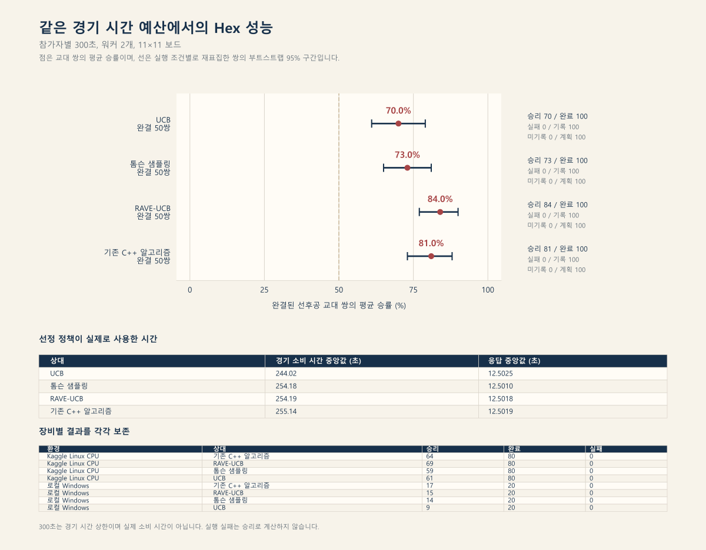
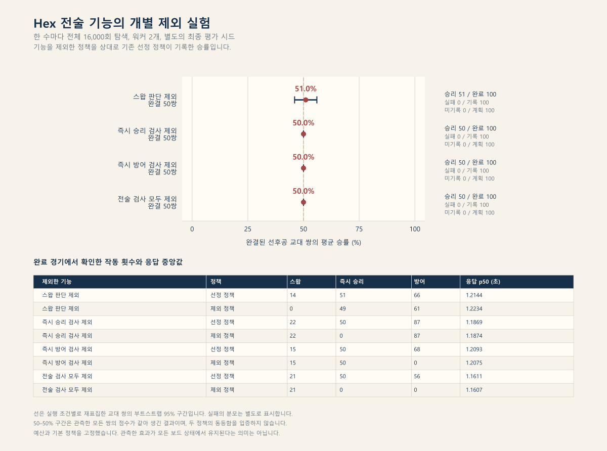
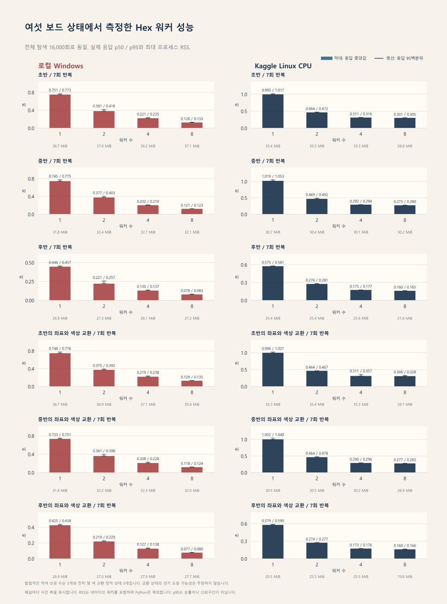
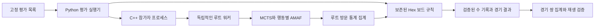

# Hex 게임 AI: 재현 가능한 CPU 탐색

**한국어** | [English](README.md)

[포트폴리오 설명](https://park-dongmyung.com/projects/project-06/) | [소스와 평가 기록 다운로드](https://park-dongmyung.com/downloads/ai-and-games-source/)

Hex는 돌을 번갈아 놓아 자신에게 지정된 양쪽 변을 끊기지 않는 경로로
연결하는 보드게임입니다. 이 프로젝트는 현재 보드와 자신의 색상, 차례,
탐색에 사용할 자원을 입력받아 유효한 수 또는 허용된 첫 수 교환을 선택합니다.
심판 프로그램은 선택한 수가 규칙에 맞는지 확인하고 경기 기록을 남깁니다.
제한된 CPU 시간 안에서 좋은 수를 고르는 것과 그 판단의 성능을 재현 가능한
기록으로 설명하는 것이 목표입니다.

몬테카를로 트리 탐색(MCTS), RAVE, 톰슨 샘플링과 C++ 루트 병렬 탐색으로 Hex를 플레이하는 CPU 기반 게임 AI 프로젝트입니다. 초기 프로젝트와 경기 기록을 보존하면서 탐색 통계의 오류를 수정하고, 고정 대국 목록의 비교 평가, 동일한 외부 경기 예산과 소스 빌드 검증을 추가했습니다.

이 문서의 **초기 에이전트**는 최초 제출한 Python 및 C++ 구현을 뜻하며, **현재 에이전트**는 탐색 통계와 실행 도구를 개선한 공개 구현을 뜻합니다.

## 에이전트가 수를 선택하는 방법

**MCTS는 현재 보드에서 가능한 진행을 반복적으로 탐색하는 몬테카를로 트리
탐색**입니다. 탐색 중인 위치에서 가상 대국을 끝까지 진행하는 과정을
**롤아웃**이라고 하며, 그 승패를 수별 통계에 반영합니다. 탐색 한 회는
이 과정의 한 차례이고 실제 대국 한 경기와는 다릅니다. **UCB**는 지금까지
좋아 보인 수와 충분히 살펴보지 않은 수 사이에서 탐색을 배분합니다.
**톰슨 샘플링**(TS)은 수별 승률 추정의 불확실성을 반영한 확률 분포에서
값을 뽑아 다음에 살펴볼 수를 고릅니다.

**AMAF**는 가상 대국에서 같은 플레이어가 나중에 둔 수도 해당 위치의 후보
수에 대한 간접 근거로 모으는 방법입니다. **RAVE**는 이 간접 근거와 그 수를
직접 탐색한 결과를 섞되, 직접 관측이 쌓일수록 간접 근거의 비중을 줄입니다.
RAVE-TS는 이 방식에 톰슨 샘플링을 결합합니다. **루트 워커**는 현재 보드에서
각자 독립된 탐색 트리를 만드는 작업 단위이며, 탐색을 마친 뒤 첫 수 후보의
통계를 합쳐 실제로 둘 수를 선택합니다.

## 프로젝트 개요

| 영역 | 구현 내용 |
| --- | --- |
| 탐색 알고리즘 | 동일한 엔진에서 UCB, 톰슨 샘플링, RAVE-UCB, RAVE-TS 비교 |
| 정확성 | 차례별 승률 해석, 노드별 행동 AMAF 통계, 종료 상태 처리 |
| 네이티브 실행 | C++17, union-find 연결성 판정, 독립적인 루트 워커, 자원 제한 설정 |
| 평가 | 고정 대국 목록, 선후공 교대 쌍, 개발 평가와 최종 평가 분리, 연결 경로 재검증 |
| 재현성 | 표준 라이브러리 기반 Python CLI, 소스 빌드, 경기별 저장, 실행 환경과 빌드 해시 기록 |

현재 에이전트는 실행 중 탐색으로 수를 선택합니다. GPU나 학습된 정책, 신경망 체크포인트가 필요하지 않습니다. 초기의 셀프플레이와 AlphaZero 방식 탐색 자료는 과거 시도의 기록으로 보존하며, 이번 공개 결과를 신경망 학습 성능으로 설명하지 않습니다.

## 비교 결과를 읽는 방법

여기서 **정책**은 탐색 중 어떤 수를 선택할지 정하는 규칙이며 학습된 신경망을
뜻하지 않습니다. **시드**는 난수 생성기의 시작 상태를 정하는 값입니다.
**고정한 평가 목록**에는 최종 평가 전에 정한 정책 설정과 상대, 시작 조건,
시드 및 자원 한도를 기록합니다. 최종 결과를 보고 그 결과에 맞게 설정을
다시 고르지 않기 위한 절차입니다.

**선후공 교대 쌍**은 선언한 같은 시작 조건에서 두 에이전트의 시작 역할을
바꿔 치르는 경기 묶음입니다. 시작 순서의 영향을 줄이기 위한 비교이며,
양쪽 경기가 모두 기록돼야 완결 쌍으로 집계합니다. 스왑 규칙은 첫 수 이후
두 번째 플레이어가 색상과 역할을 교환할 수 있게 합니다. **예산**은 탐색에
허용한 자원으로, 횟수를 맞추면 가상 탐색량을 비교하고 경기 시간을 맞추면
한 경기에 누적된 실제 응답 시간을 기준으로 비교합니다.

승률은 명시한 상대에 대한 대국 성능, 실패 수는 실행의 안정성, 시간과 메모리는
자원 사용량을 보여 줍니다. 쌍 단위 신뢰구간은 선후공 교대 묶음을 통째로
다시 추출해 표본의 불확실성을 계산하므로 서로 관련된 경기를 독립적으로
취급하지 않습니다. 기능 제외 실험은 나머지 비교 조건을 유지하고 기능 하나를
꺼서 기여를 살펴보는 방법입니다. 승률이 달라지지 않아도 응답 시간에는
차이가 나타날 수 있으므로 두 결과를 구분합니다.

## 선정 정책의 검증 범위 확대

이번 추가 검증은 앞서 선정한 정책을 더 충분한 조건에서 평가합니다.
참가자마다 외부에서 측정하는 **경기 시간 상한 300초**를 적용하고, 같은 실행
조건의 초기 알고리즘 비교, 전술 기능의 개별 제외 실험과 여섯 보드 상태의
워커 측정을 추가했습니다. 브리지 방어와 수 정렬을 사용하는 RAVE-TS 및
`rave_k=1000` 설정은 유지합니다. 추가 최종 결과로 다른 정책을 다시
선택하지 않았습니다. 측정 결과와 검증 범위를 구분해 설명합니다.

| 평가 | 동일하게 맞춘 조건 | 추가 평가 규모 |
| --- | --- | --- |
| 경기 시간 비교 | 같은 장비, 참가자별 워커 2개, 동일한 외부 시간 배분 | 네 상대에게 각각 100경기와 선후공 교대 50쌍 |
| 전술 기능 제외 | 동일한 개선 엔진, 수당 전체 탐색 16,000회, 워커 2개 | 스왑 판단, 즉시 승리 검사, 즉시 방어, 두 검사의 동시 제외를 각각 100경기 |
| 워커 측정 | 동일한 비종료 보드 여섯 개와 전체 탐색 횟수 | 워커 1개, 2개, 4개, 8개를 Windows와 Kaggle에서 각각 측정 |

이전에 수행한 **532경기와 재생 검증한 16,768수는 그대로 보존합니다.**
이전 개발 단계의 선택, 최종 고정 횟수 평가, 짧은 시간 비교와 원본 소스의
4경기 기준 비교를 이번 추가 실험으로 바꾸어 설명하지 않습니다. 새 평가의
시드는 이전 목록과 구분하며, 새 시드라는 이유만으로 처음 보는 시작 좌표라고
주장하지 않습니다.

### 탐색 횟수뿐 아니라 실제 경기 시간도 동일하게 배정



경기 시간 비교 400경기를 모두 기록하고 완료했습니다. 실패와 미기록은 각각 0건입니다.

| 상대 | RAVE-TS 승리 / 완료 경기 | 완료 경기 승률 | 완결 쌍 | 쌍 부트스트랩 95% 구간 | 실패 / 예정 경기 |
| --- | ---: | ---: | ---: | ---: | ---: |
| 초기 알고리즘 어댑터 (`benchmark_legacy`) | 81 / 100 | 81.0% | 50 | 73.0–88.0% | 0 / 100 |
| RAVE-UCB | 84 / 100 | 84.0% | 50 | 77.0–90.0% | 0 / 100 |
| 톰슨 샘플링(TS) | 73 / 100 | 73.0% | 50 | 65.0–81.0% | 0 / 100 |
| UCB | 70 / 100 | 70.0% | 50 | 61.0–79.0% | 0 / 100 |

300초는 한 참가자의 모든 응답에 적용하는 경기 시간 상한이며, 매 경기에서
300초를 모두 사용한다는 뜻은 아닙니다. 실행기는 입출력 전달 시간을 포함해
응답을 측정하고, 두 엔진에 동일한 적응형 수당 예산을 V3로 전달합니다.
전술 검사에서 바로 수를 선택하거나 경기가 일찍 끝나면 시간이 남을 수
있습니다. 따라서 실제 사용 시간, 완료 경기 기준 승률, 실패의 분모, 미기록
경기와 완결된 경기 쌍의 수를 함께 공개합니다.

주요 신뢰구간은 같은 장비와 소스 어댑터 조건 안에서 선후공 교대 쌍을 다시
추출해 계산합니다. Windows와 Kaggle의 결과도 각각 제공합니다. 하나의 CPU
작업에서 두 독립 경기를 병행할 수 있으므로 장비를 단독으로 사용한 지연
측정으로 설명하지 않습니다. 대국 결과는 명시한 내부 상대와 예산의 범위에서
해석합니다.

[시간 예산 평가 집계](reports/deep/aggregates/shared-time.json)와 [실제 응답 및 메모리 측정](reports/deep/analysis/shared-time-costs.json)을 함께 제공합니다. 상대마다 Windows 20경기, Xeon 기반 Kaggle 60경기, EPYC 기반 Kaggle 20경기입니다. UCB 상대의 Windows 구간은 9/20이므로 합산 승률을 모든 장비에서의 우위로 해석하지 않습니다. 응답 18,514개와 참가자 및 경기의 조합 800개에서 외부 시간 한도 위반은 0건이었습니다. 노드 한도는 트리 확장을 제한하며, 한도에 도달해도 롤아웃은 계속합니다. 초기 알고리즘의 메모리 할당 방식은 보존했으므로 동일 RAM 상한 비교는 아닙니다.

### 전술 기능의 개별 효과와 실행 비용



전술 400경기를 모두 완료했으며 실패와 미기록은 0건입니다.

| 제외한 기능 | 선정 정책 승리 / 완료 경기 | 완결 쌍 | 쌍 평균 및 95% 구간 |
| --- | ---: | ---: | --- |
| 스왑 판단 | 51 / 100 | 50 | 51.0%, 46.0–56.0% |
| 즉시 승리 검사 | 50 / 100 | 50 | 50.0%, 50.0–50.0% |
| 즉시 방어 검사 | 50 / 100 | 50 | 50.0%, 50.0–50.0% |
| 두 전술 검사 | 50 / 100 | 50 | 50.0%, 50.0–50.0% |

이 결과로 대국 우위가 확인됐다고 설명하지 않습니다. 세 즉시 검사 조건은
관측한 교대 쌍이 모두 1승 1패여서 쌍을 다시 추출해도 평균이 50%입니다.
50–50%라는 구간은 관측된 쌍 점수의 변동이 없다는 뜻이며 전체 상황의
정확한 승률이나 기능의 동등함을 증명하지 않습니다. 전체 수순이 일치한
쌍은 즉시 승리에서 48/50, 방어와 두 검사에서 각각 27/50이었습니다.
즉시 승리에서 달라진 두 쌍도 마지막 승리 좌표만 달랐습니다. 네 비교의
공통 일반 탐색 상태 7,407개는 기록된 워커 시드와 선택 수가 모두 같았습니다.

같은 보드와 차례 및 색상이 기록된 승리 상태 50개에서는 즉시 검사의
외부 응답 중앙값이 0.191ms, 일반 탐색은 231.654ms였습니다. 방어 상태
68개에서는 각각 0.256ms와 687.677ms였습니다. 일부 상태에서는 선택한
수도 다르므로 같은 입력의 조건부 응답 비용이며 전체 에이전트의 속도 향상
배수가 아닙니다. 전체 수의 응답 중앙값은 약 1.16–1.22초였습니다.
최종 진단 결과로 선정 정책을 다시 조정하지 않았습니다.

네 기능 비교는 서로 관련된 진단 실험입니다. 실제 스왑, 즉시 승리와 방어의
작동 횟수 및 응답 시간을 함께 기록합니다. 기능이 드물게 작동하면 승률만으로
효과를 판단하기 어려울 수 있습니다. 효과를 확인하지 못했다는 이유로 두
설정이 동등하다고 주장하지 않으며, 네 비교의 보정 없는 구간으로 유의한
결과를 선언하지 않습니다.



Windows와 Kaggle Linux에서 같은 보드 해시를 사용해 각각 168회, 총 336회 탐색을 완료했습니다. 6개 상태에서 워커 1개, 2개, 4개, 8개를 각각 7회 측정했으며, 모든 요청의 전체 반복 횟수는 16,000회입니다. 환경별 총 2,688,000회, 두 환경을 합해 5,376,000회입니다.

초반, 중반, 후반 상태는 적색 선공의 합법적인 수순을 재생한 2번째, 41번째, 81번째 차례입니다. 나머지 세 개는 이를 전치하고 색을 교환한 비종료 정적 상태이며, 적색 선공 경기에서 도달 가능한 수순이라고 주장하지 않습니다.

| 환경 | 워커 4개의 응답 속도 배수, 1개 대비 | 워커 8개의 응답 시간 단축률, 4개 대비 | 관측 논리 CPU |
| --- | --- | --- | --- |
| 로컬 Windows | 3.34–3.68× | 39.52–43.33% | 16 |
| Kaggle Linux | 3.20–3.49× | 1.60–8.36% | 4 |

배수와 단축률은 각 환경 안에서 계산했습니다. 서로 다른 하드웨어, 컴파일러와 운영체제를 함께 바꾼 측정이므로 환경 간 차이를 알고리즘 개선 효과나 운영체제의 영향으로 분리할 수 없습니다. Kaggle은 CPU 4개 할당 안에서 워커 8개를 실행했으며, 이를 CPU 8개 확보로 해석할 수 없습니다.

지연 시간은 수를 요청한 뒤 응답을 받을 때까지 걸린 시간으로, 이 측정에서는
작을수록 더 빨리 답한 것입니다. p50은 중앙값이고 p95는 관측한 응답 중 느린
쪽의 경향을 나타냅니다. 최대 RSS는 프로세스가 실제 메모리에 올려 둔 용량의
관측 최대값이며 MiB 단위로 표시합니다. 속도 향상 비율은 같은 장비와 보드에서
응답 시간을 비교한 값이며 승률 향상 비율은 아닙니다.

아래 값은 요청 전송부터 응답 수신까지 걸린 시간의 p50 / p95이며 단위는 ms입니다. p95는 7회 측정값을 선형 보간한 기술 통계입니다.

**로컬 Windows**

| 상태 | 워커 1개 | 워커 2개 | 워커 4개 | 워커 8개 |
| --- | --- | --- | --- | --- |
| 초반, 2번째 차례 | 750.8 / 772.8 | 380.9 / 418.0 | 221.4 / 235.4 | 126.1 / 132.5 |
| 중반, 41번째 차례 | 744.5 / 775.3 | 377.1 / 403.3 | 202.1 / 210.5 | 120.8 / 122.6 |
| 후반, 81번째 차례 | 446.0 / 456.9 | 220.9 / 256.9 | 129.6 / 137.5 | 78.4 / 82.9 |
| 초반 정적 대칭 상태 | 748.1 / 776.0 | 374.6 / 392.5 | 219.4 / 238.1 | 128.7 / 134.6 |
| 중반 정적 대칭 상태 | 733.3 / 751.0 | 361.1 / 398.3 | 207.9 / 227.9 | 117.8 / 123.6 |
| 후반 정적 대칭 상태 | 425.5 / 438.4 | 219.0 / 229.4 | 127.3 / 138.0 | 76.9 / 80.2 |

설정별 7회 측정에서 가장 높게 기록된 네이티브 프로세스 피크 RSS, MiB:

| 상태 | 워커 1개 | 워커 2개 | 워커 4개 | 워커 8개 |
| --- | --- | --- | --- | --- |
| 초반, 2번째 차례 | 36.73 | 36.96 | 36.21 | 37.12 |
| 중반, 41번째 차례 | 31.84 | 32.39 | 32.70 | 32.06 |
| 후반, 81번째 차례 | 26.91 | 27.31 | 28.07 | 27.20 |
| 초반 정적 대칭 상태 | 36.74 | 36.86 | 37.13 | 35.83 |
| 중반 정적 대칭 상태 | 31.84 | 32.21 | 32.29 | 31.97 |
| 후반 정적 대칭 상태 | 26.88 | 26.99 | 27.89 | 27.69 |

**Kaggle Linux**

| 상태 | 워커 1개 | 워커 2개 | 워커 4개 | 워커 8개 |
| --- | --- | --- | --- | --- |
| 초반, 2번째 차례 | 994.7 / 1017.2 | 463.5 / 472.0 | 310.5 / 316.4 | 300.9 / 304.7 |
| 중반, 41번째 차례 | 1018.6 / 1053.0 | 469.1 / 492.0 | 292.1 / 293.6 | 273.2 / 279.9 |
| 후반, 81번째 차례 | 574.6 / 580.6 | 276.2 / 281.2 | 175.1 / 177.0 | 160.5 / 164.6 |
| 초반 정적 대칭 상태 | 996.4 / 1021.1 | 463.6 / 466.6 | 310.5 / 356.9 | 305.6 / 327.6 |
| 중반 정적 대칭 상태 | 1002.1 / 1039.9 | 464.1 / 477.6 | 289.8 / 296.2 | 276.7 / 282.7 |
| 후반 정적 대칭 상태 | 578.6 / 590.0 | 273.9 / 276.8 | 173.2 / 175.8 | 160.4 / 166.1 |

설정별 7회 측정에서 가장 높게 기록된 네이티브 프로세스 피크 RSS, MiB:

| 상태 | 워커 1개 | 워커 2개 | 워커 4개 | 워커 8개 |
| --- | --- | --- | --- | --- |
| 초반, 2번째 차례 | 35.41 | 35.52 | 35.26 | 28.77 |
| 중반, 41번째 차례 | 30.67 | 30.38 | 30.14 | 30.20 |
| 후반, 81번째 차례 | 25.39 | 25.36 | 25.62 | 21.57 |
| 초반 정적 대칭 상태 | 35.29 | 35.40 | 35.29 | 29.07 |
| 중반 정적 대칭 상태 | 30.48 | 30.46 | 30.23 | 26.86 |
| 후반 정적 대칭 상태 | 25.48 | 25.45 | 25.48 | 19.75 |

모든 응답이 비어 있는 합법적인 위치를 선택했으며, 워커별 반복 합계가 정확히 16,000회였습니다. 기록된 노드 한도 도달은 0건입니다. RSS는 네이티브 워커를 포함하고 Python 실행기는 제외합니다. Windows는 PeakWorkingSetSize를, Linux는 VmHWM을 기록하므로 환경 간 메모리 수치도 같은 계측기의 결과로 해석하지 않습니다. 메모리 설정은 네이티브 노드 풀의 한도이며 운영체제가 강제하는 전체 프로세스 메모리 상한은 아닙니다. 스왑과 즉시 전술을 비활성화해 모든 요청이 탐색 경로를 거쳤습니다.

각 요청은 새 네이티브 프로세스를 사용했으며, 설정은 고정된 순서로 측정했습니다. 요청부터 응답까지의 시간은 Python의 프로세스 생성 호출 시간을 제외하지만, 아직 진행 중인 네이티브 초기화 비용은 포함할 수 있습니다. 반복을 독립 트리에 나누면 탐색 경로와 반복당 연산량도 달라지므로 배수를 순수 병렬 효율이나 승률 향상으로 해석하지 않습니다. 7회 반복의 p95는 운영 환경의 지연 상위 구간을 정밀하게 추정하지 않으며, 이 결과로 선정 정책을 다시 조정하지 않았습니다. 원시 기록은 `reports/deep/benchmarks/windows.json` 및 `reports/deep/benchmarks/kaggle.json`에 보존합니다.

워커 그래프에는 장비와 보드별 응답 p50 및 p95와 최대 프로세스 RSS를
남깁니다. RSS는 네이티브 워커를 포함하며 Python 실행기는 제외합니다.
메모리 측정값이 없으면 미측정으로 표시합니다. 워커를 늘려도 CPU 코어 수가
증가하지 않으며 처리 속도를 승률로 해석하지 않습니다.
[선택 설치하는 Matplotlib 그래프 도구](tools/figures/)는 Python 3.11 이상을
사용하며 Python 3.10 이상인 에이전트 실행 환경과 분리합니다.

### 서로 다른 세 가지 초기 구현 비교

| 비교 대상 | 의미 |
| --- | --- |
| `legacy_ts` | 개선 엔진 내부의 진단 정책이며 원본 소스 자체가 아님 |
| `--legacy`로 다시 빌드한 보존 소스 | 초기 알고리즘과 워커 8개의 원래 시간 배분을 사용하며 과거 4경기 비교를 별도 보존 |
| `benchmark_legacy` | 초기 알고리즘에 시드, 워커 수, 외부 예산, 시간 확인과 측정 기록만 추가한 동일 조건 어댑터 |

동일 조건 어댑터는 초기 수 선택, 확장, 롤아웃, 보상, 스왑과 전술 판단을
유지하며 AMAF가 갱신되지 않던 상태도 수정하지 않습니다. 변경 내역과 생성
소스로 이를 확인할 수 있습니다. 원래 실행 파일과 바이트까지 같다는 뜻은
아닙니다. 초기의 워커별 탐색 상한과 제한 없는 트리 증가는 유지하고, 개선
엔진의 노드 및 메모리 제한도 명시하므로 메모리 사용량을 동일하게 맞춘
비교라고 설명하지 않습니다.

공개 CPU 패키징 도구는 Kaggle에서 실제로 전체 실행을 확인했습니다.
소스 추출과 해시 확인, 소스 빌드, 개선 구현과 원본의 검사, ASan 및 UBSan
검사와 짧은 V3 대국 4경기를 완료했습니다. 이는 도구가 처음부터 끝까지
실행되는지 확인한 것이며, 300초 에이전트의 대국 성능이나 독립적인 외부인의
검증을 뜻하지 않습니다. 구체적인 정의와 목록 및 명령은
[추가 실험 기록](docs/experiments.ko.md)과
[재현 안내](docs/reproducibility.ko.md)에 있습니다.

최신 공개 CPU 도구의 실제 Kaggle 실행은 Python 테스트 107개, C++ 자체 검증 15개 및 ASan/UBSan 프로토콜 검사 6개를 통과했습니다. 짧은 V3 대국 4경기를 완료하고 저장한 100수를 재생 검증했습니다. 별도의 체크포인트 확인 작업은 첫 평가 경기 전에 중단하여 0경기를 기록했습니다. 이 통합 점검과 중단 점검은 400경기 성능 평가에 더하지 않습니다. [공개 실행 근거](docs/deep-runtime.ko.md)에 소스 버전별 범위를 설명합니다.

## 보존한 고정 횟수 평가 결과

개발 평가 160경기를 모두 완료했으며 실행 실패는 0건이었습니다. 네 정책의 균형 대진에서 RAVE-TS가 48경기 중 44승을 기록해 사전 기준에 따라 선택됐습니다. 이는 정책을 고르는 데 사용한 개발 점수입니다.

| 개발 정책 | 승리 / 완료 경기 | 개발 승률 |
| --- | --- | --- |
| RAVE-TS | 44 / 48 | 91.7% |
| RAVE-UCB | 22 / 48 | 45.8% |
| 톰슨 샘플링 | 18 / 48 | 37.5% |
| UCB | 12 / 48 | 25.0% |

각 정책은 나머지 세 정책과 16경기씩 비교했습니다. 표의 정책별 분모를 더하면 각 경기를 두 번 세게 되므로 네 정책 비교의 전체 규모는 96경기입니다. 별도의 기능 비교는 64경기였습니다. 선택 가능한 변경 네 가지는 모두 채택 기준을 통과하지 못해 중단했으며, 최종 설정은 <strong>RAVE-TS, 브리지 방어 사용, 수 정렬 사용, `rave_k=1000`</strong>으로 고정했습니다. 선택과 해시는 [선택 기록](reports/selection.json) 및 [최종 고정 기록](reports/final-freeze.json)에 있습니다.

<!-- FINAL_RESULTS_BEGIN -->


고정한 최종 대국 256경기의 기록을 확인했습니다. 완료 256경기, 실패 0건, 미기록 0건입니다. 승률 분모는 완료 경기이며 실패를 승리로 바꾸지 않았습니다.

| 상대 | RAVE-TS 승리 / 완료 경기 | 승률 | 완료 쌍 | 쌍 단위 95% 구간 | 실패 |
| --- | --- | --- | --- | --- | --- |
| legacy_ts | 55 / 64 | 85.9% | 32 | 78.1–93.8% | 0 |
| RAVE-UCB | 54 / 64 | 84.4% | 32 | 76.6–92.2% | 0 |
| Thompson sampling | 53 / 64 | 82.8% | 32 | 75.0–90.6% | 0 |
| UCB | 57 / 64 | 89.1% | 32 | 79.7–96.9% | 0 |

새 시드의 결과는 설정 선정에 사용하지 않았습니다. 내부 상대, 강제 시작 조건과 CPU 예산의 범위에서 해석합니다. [최종 집계](reports/aggregates/final-policy.json)에는 환경별 결과와 실패 내역도 있습니다.
<!-- FINAL_RESULTS_END -->

결과는 대국 성능, 실행 안정성, 시뮬레이션 처리량으로 구분해 해석합니다. 탐색의 정확성 수정은 단기 대국에서 승률 상승이 확인되지 않더라도 유지하며, 선택 가능한 설정 변경은 [사전에 정한 실험 계획](reports/study-plan.json)의 채택 기준을 통과한 경우에만 반영합니다.

## 문제와 접근 방법

초기 Python 에이전트는 루트 플레이어의 승리를 모든 노드에 같은 기준으로 저장하고, 상대 차례에도 그 값을 최대화했습니다. 개선 구현은 각 노드에서 수를 둘 플레이어의 승리를 기록하고, 부모가 자식의 수를 평가할 때 승률을 반대로 해석합니다. 이로써 상대도 자신의 승리를 목표로 탐색하도록 수정했습니다.

초기 RAVE 갱신은 트리에서 이미 둔 수를 이후 롤아웃의 수 목록에서 찾는 방식이었습니다. 돌을 놓는 Hex에서는 같은 칸에 다시 둘 수 없으므로 해당 수가 그 목록에 나타나지 않습니다. 개선 구현은 각 조상 노드 이후에 그 노드의 플레이어가 실제로 둔 수를 트리 경로와 롤아웃에서 함께 수집합니다. 이 정보를 노드별 행동 통계인 AMAF로 저장하고, 수를 선택할 때 직접 탐색 통계와 결합합니다.

두 수정은 별도의 정확성 검사로 확인합니다. 초기 C++ 코드의 플레이어별 보상 기준은 Python 코드와 달랐으므로 Python의 상대 차례 오류가 모든 과거 구현에 있었다고 설명하지 않습니다. 읽기 쉬운 [Python 참조 구현](hexai/reference.py)은 보존된 심판의 규칙을 이용하며, 규모가 큰 CPU 실험은 [네이티브 엔진](native/hex_search.cpp)으로 실행합니다.

고정한 11×11 상태 61개에서 상황별 응답 488개가 모두 통과했고, V2와 V3의 수 및 판단 이유를 비교한 244개 조합이 모두 일치했습니다. 잘못된 입력과 종료 상태의 거부 검사 4개도 통과했습니다. [상황별 검증 기록](reports/deep/correctness/scenarios/receipt.json)은 대국 승률과 구분한 정확성 근거입니다.

## 시스템 구조



한 경기의 두 에이전트는 같은 장비에서 실행합니다. 로컬과 Kaggle CPU에 일을 나눌 때도 선후공을 교대한 두 경기 전체를 한 장비에 배정합니다. 알고리즘과 통신 방식, 메모리 제한의 범위는 [아키텍처 설명](docs/architecture.ko.md)에 정리했습니다.

## 실험과 검증

개발 비교에서는 탐색 엔진, 강제 시작 수, 시드, 보드 크기와 수당 전체 탐색 예산을 맞춥니다. 정책과 선택 가능한 기능 설정을 결정한 뒤 새로운 시드로 최종 평가를 진행하며, 최종 결과를 보고 다른 정책으로 다시 선택하지 않습니다.

승리는 수 기록을 재생해 실제 연결 경로가 확인된 경우에만 집계합니다. 불법 수, 응답 시간 초과, 프로세스 오류와 프로토콜 오류는 실패로 별도 기록하고 대국 성능의 승리로 바꾸지 않습니다. 주된 신뢰구간은 완결된 선후공 교대 쌍을 단위로 계산합니다. 경기별 Wilson 구간도 제공하지만 같은 쌍의 두 경기는 서로 연관되므로 보조 지표로 해석합니다.

첫 공개 때의 단일 상태 워커 비교는 전체 시뮬레이션 횟수를 동일하게 유지한 상태에서 진행했습니다. 11×11 고정 보드에서 탐색 16,000회의 외부 응답 시간 중앙값은 Windows의 1워커 0.754초, 8워커 0.131초였고, Kaggle에서는 각각 1.897초, 0.683초였습니다. 반복 수는 Windows 7회, Kaggle 5회이며 같은 장비 내 비교로 해석합니다. 워커 8개를 실행해도 물리적인 CPU 코어가 늘어나지는 않습니다. 전체 측정표와 메모리 해석은 [실험 기록](docs/experiments.ko.md)에 있습니다.

최종 고정 횟수 목록은 256경기입니다. 선택하지 않은 세 정책과 현재 엔진의 `legacy_ts` 제어 조건을 상대로 각각 선후공 교대 32쌍을 배정합니다. 별도로 초기 실행 파일과 비교하는 시간 기준 4경기를 마련하지만, 두 엔진의 시간 배분 방식이 다르므로 실행 확인의 범위로 해석하며 충분한 표본의 성능 비교로 제시하지 않습니다.

비교 조건은 [실험 기록](docs/experiments.ko.md)과 [고정한 선택 결과](reports/selection.json), 실행 과정은 [재현 가이드](docs/reproducibility.ko.md)에서 확인할 수 있습니다.

## 한계와 과거 기록

최종 평가는 명시한 내부 상대, 시작 조건과 CPU 예산에서의 결과입니다. 전체 Hex 에이전트의 순위나 Davis 및 HexHex 상대 경기의 재현 결과를 의미하지 않습니다.

초기의 11×11 경기 스크린샷 네 장과 [메타데이터](assets/results/recorded-matches.csv)는 그대로 보존했습니다.

| 과거 에이전트 | 상대 | 기록된 시작 순서 | 결과 |
| --- | --- | --- | --- |
| RAVE-TS | Davis 7 | 선공 | 승리 |
| RAVE-TS | Davis 10 | 선공 | 승리 |
| RAVE-TS | HexHex | 후공 | 패배 |
| MCTS 기준 에이전트 | HexHex | 후공 | 패배 |

Davis는 초기 프로젝트에서 상대한 온라인 사이트 에이전트입니다. 네 장의 이미지는 개별 경기 기록이며, 외부 상대의 실행 파일과 정확한 실행 조건, 당시 전체 토너먼트 CSV는 저장소에 포함되어 있지 않습니다. 보존된 네 경기의 캡처는 이번 내부 정량 평가에 합산하지 않습니다.

새로운 엔진의 `legacy_ts`는 초기 RAVE가 갱신되지 않을 때의 통계 가중 방식을 비교하기 위한 제어 조건입니다. 현재 엔진의 상태 처리와 실행 구조를 공유하므로 초기 실행 파일 자체나 과거 토너먼트의 완전한 재현으로 해석하지 않습니다. 과거 제출본 이후의 모든 변경 효과를 개별적으로 입증하는 비교도 아닙니다.

## 소스에서 실행하기

Python 3.10 이상과 C++17 컴파일러인 `g++`, `clang++` 또는 `zig c++`가 필요합니다. 현재 실행기는 Python 표준 라이브러리만 사용합니다. Windows, Linux 또는 WSL에서 저장소 루트를 기준으로 실행합니다.

```bash
python -m hexai doctor
python -m hexai build
python -m unittest discover -s tests -v
python -m hexai predict --board "R00,000,000" --colour B --turn 2 --policy rave_ts --iterations 1000 --workers 1 --swap 0
```

컴파일러가 자동으로 검색되지 않으면 `PATH`에 추가하거나 `doctor`와 `build`에 `--compiler`를 지정합니다. 빌드 결과와 해시 기록은 `.local/bin/`에 저장되며 초기 배포 실행 파일을 덮어쓰지 않습니다.

개발 단계의 정책 비교를 다시 실행하려면 다음 명령을 사용합니다.

```bash
python -m hexai evaluate --config configs/development-policy.json --output .local/development-policy
python -m hexai evaluate --config configs/development-policy.json --output .local/development-policy --resume
```

두 번째 명령은 동일한 평가 목록을 이어 실행하고 검증된 완료 경기 파일을 건너뜁니다. 종료 시점에 진행 중이던 경기는 다시 실행하지만 이미 완료한 전체 평가를 처음부터 반복하지 않습니다. 전체 대국 비교는 간단한 실행 확인보다 오래 걸립니다. 최종 평가, 로컬과 Kaggle의 분담, 결과 집계와 수 기록 검증은 [재현 가이드](docs/reproducibility.ko.md)를 참고해 주세요.

## 코드와 자료

```text
hexai/                      현재 CLI, 평가 실행기와 Python 참조 구현
native/                     현재 C++17 탐색 소스
configs/                    개발 및 최종 평가의 고정 대국 목록
reports/                    실험 계획, 측정 결과와 공개 검증 자료
tests/                      현재 정확성 검사와 평가 도구 검사
docs/                       영어 기본 문서와 한국어 문서
engine/                     보존된 과제 심판과 초기 Python 에이전트
deployment/                 보존된 초기 네이티브 소스, 실행 파일과 실행 환경
assets/results/             보존된 경기 이미지와 과거 메타데이터
```

소스 ZIP은 공개 저장소와 같은 구조를 사용하고, 개선 구현과 초기 배포 실행 파일을 포함한 과거 자료를 함께 제공합니다. 공개 경기 기록은 `reports/`에 보존하며 새로 생성한 현재 실행 파일, 임시 작업 디렉터리, 인증정보와 개인 기록은 제외합니다. 현재 장비에 맞게 소스에서 빌드하며, Windows 실행 파일을 Linux에서 실행하거나 과거 Linux 실행 파일을 Windows에서 실행하는 방식으로 검증하지 않습니다.

이 저장소는 University of Manchester의 COMP34111 AI & Games 과목 Group 026 프로젝트에서 시작되었습니다. 문서화된 개인 기여는 네 가지 Python 변형, Hex 휴리스틱, C++ 이전과 루트 병렬화입니다. 제공된 심판과 팀 프레임워크는 공동 작업물로 명시합니다. 출처는 [연구 참고문헌](docs/references.md), [초기 연구 README](engine/README.ko.md), [초기 배포 README](deployment/README.ko.md)에서 확인할 수 있습니다.

- [아키텍처](docs/architecture.ko.md) / [English](docs/architecture.md)
- [실험](docs/experiments.ko.md) / [English](docs/experiments.md)
- [재현 가이드](docs/reproducibility.ko.md) / [English](docs/reproducibility.md)
- [한계와 검증 범위](docs/limitations.ko.md) / [English](docs/limitations.md)


[선택 실행하는 분석 도구](tools/analysis/)에서 원시 기록을 다시 분석할 수 있습니다. 새 대국이나 정책 조정은 수행하지 않습니다.
