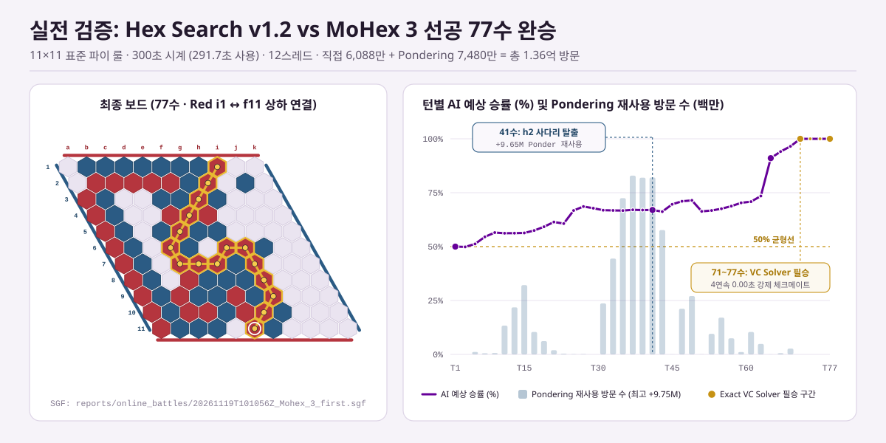
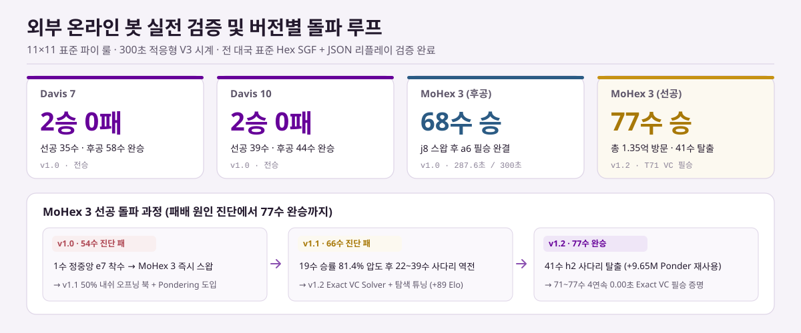
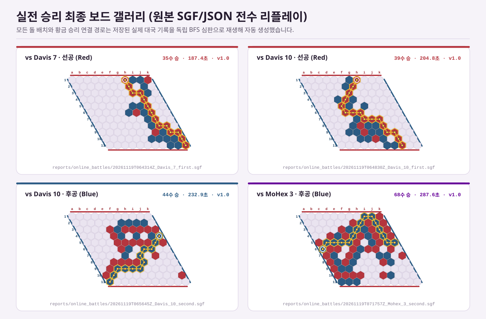
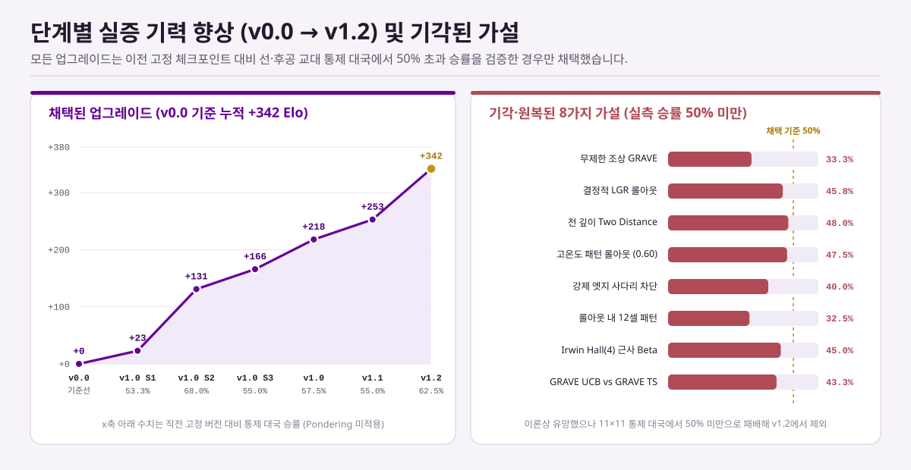

<div align="center">

# Hex Search v1.2

### 순수 CPU C++17 11×11 Hex AI 엔진 (GPU · 신경망 · 외부 라이브러리 0개)


[English README](README.md) · [기술 아키텍처 (KO)](docs/architecture.ko.md) · [Technical Architecture (EN)](docs/architecture.md)

</div>

<br/>

**Hex Search v1.2**는 GPU와 딥러닝 신경망 추론을 전혀 사용하지 않고, **단일 순수 C++17 파일(`native/hex_search.cpp`) + CPU 멀티스레딩**만으로 11×11 Hex 실전 기력을 극대화한 탐색 엔진입니다.

`v0.0` 코어 아키텍처를 출발점으로 삼아, 매 버전(`v0.0 → v1.0 → v1.1 → v1.2`)의 모든 변경 사항을 이전 고정 바이너리 대비 **선·후공 교대 통제 대국**으로 검증했습니다. 그 결과 순수 CPU 기준 `v0.0` 대비 **누적 +342 Elo**를 끌어올렸으며, 온라인 공개 봇 **Davis 7**(2승 0패), **Davis 10**(2승 0패) 전승에 이어 클래식 컴퓨터 Hex 대표 강엔진 **MoHex 3**까지 **선공(77수)과 후공(68수) 모두 격파**했습니다.

> [!IMPORTANT]
> **핵심 검증 요약**
> - **순수 CPU 통제 진화**: `v0.0 → v1.0 (+218 Elo) → v1.1 (+253 Elo) → v1.2 (+342 Elo)` · 실측 50% 미만 가설 8건 원복
> - **외부 온라인 봇 실전**: **Davis 7 (2승 0패)** · **Davis 10 (2승 0패)** · **MoHex 3 후공(68수) & 선공(77수) 완승** (8판 원본 SGF/JSON 리플레이 검증)
> - **형식 검증 오탐 0건**: 3×3 전체 **19,683개 보드** 연결성·VC Solver 미니맥스 교차 검증 + **8,784개** Dead Cell 전수 검증

<br/>

<p align="center">
  
</p>

<br/>

---

## 1. 직접 AI와 대결해 보기 (사용자 설정 지원 GUI 데모)

Python 3.10+와 C++17 컴파일러(`g++`, `clang++`, 또는 `zig c++`)만 있으면 `pip install` 없이 **우리 `v1.2` AI와 바로 클릭하며 대결**할 수 있습니다.

```bash
# 1. C++17 엔진 빌드 및 26개 자체 검증(--self-test) 자동 실행
python -m hexai build

# 2. 사람 vs AI 클릭형 GUI 보드 실행 (난이도 프리셋 + 사용자 커스텀 설정 지원)
python -m hexai play
```

> [!TIP]
> **GUI에서 지원하는 사용자 설정**
> - **원클릭 모드 전환**: **`사람 vs AI`**(직접 대결) ↔ **`온라인 봇 어시스턴트`**(Davis·MoHex 등 외부 봇 대국 브리지)
> - **난이도 프리셋 4종**: `입문` (`0.5초/수`, 2스레드) · `중급` (`2초/수`, 4스레드) · `강함` (`5초/수`, 8스레드, Pondering) · **`최강`** (`300초 V3 시계`, 12스레드, Pondering, MoHex 3 격파 풀스펙)
> - **사용자 직접 커스터마이징**: 보드 크기(`7×7 / 9×9 / 11×11`), 선공/후공 선택, 수당 고정 시간 / 전체 V3 시계, 스레드 수, Swap 규칙(`swap-pieces` / `swap-sides`), Pondering ON/OFF, Undo, SGF/JSON 자동 저장, 종료 시 **황금 승리 연결 경로 자동 하이라이트**
> - **표준 Hex GTP 연동**: `./.local/bin/hex_search --gtp --workers 12 --game-seconds 300` (HexGui / Benzene / `twogtp` 호환)

<br/>

---

## 2. 온라인 에이전트 실전 검증 결과 및 기보 증거

모든 대국은 11×11 표준 파이 룰(`swap-pieces`)과 적응형 300초 시계에서 진행되었으며, [`reports/online_battles/`](reports/online_battles/)에 원본 SGF/JSON 기보가 보관되어 있습니다. 아래 보드 이미지는 저장된 기보를 독립 심판(`tests/test_engine.py`)으로 1수부터 마지막 수까지 재생하여 직접 렌더링한 실전 증거입니다.

<p align="center">
  
</p>

<br/>

### 실전 승리 기보 보드 갤러리 (Davis 7 · Davis 10 · MoHex 3 후공)

<p align="center">
  
</p>

<br/>

### 전체 온라인 대국 상세 기록 (8판 전수 리플레이 검증 완료)

| 상대 (AI 진영) | 버전 | 결과 · 수순 | AI 시간 / 300초 | 핵심 관측 및 원본 기보 |
| :--- | :---: | :---: | :---: | :--- |
| **Davis 7** (선공 Red) | `v1.0` | **승리 · 35수** | 187.4초 | 중앙 주도권 장악 후 `proven_win` 조기 완승 ([SGF](reports/online_battles/20261119T064314Z_Davis_7_first.sgf) · [JSON](reports/online_battles/20261119T064314Z_Davis_7_first.json)) |
| **Davis 7** (후공 Blue) | `v1.0` | **승리 · 58수** | 272.4초 | `j8` 스왑 후 58수 장기전 `k4` `proven_win` (시계 효율 90.8%) ([SGF](reports/online_battles/20261119T063451Z_Davis_7_second.sgf) · [JSON](reports/online_battles/20261119T063451Z_Davis_7_second.json)) |
| **Davis 10** (선공 Red) | `v1.0` | **승리 · 39수** | 204.8초 | 스왑 이후 중앙 연결망 구축, 39수 완승 ([SGF](reports/online_battles/20261119T064830Z_Davis_10_first.sgf) · [JSON](reports/online_battles/20261119T064830Z_Davis_10_first.json)) |
| **Davis 10** (후공 Blue) | `v1.0` | **승리 · 44수** | 232.9초 | 비스왑 진행 후 좌↔우 가상 연결 완성, 44수 완승 ([SGF](reports/online_battles/20261119T065645Z_Davis_10_second.sgf) · [JSON](reports/online_battles/20261119T065645Z_Davis_10_second.json)) |
| **MoHex 3** (후공 Blue) | `v1.0` | **승리 · 68수** | 287.6초 | `j8` 스왑 후 68수 접전 끝에 `a6` `proven_win` 완승 ([SGF](reports/online_battles/20261119T071757Z_Mohex_3_second.sgf) · [JSON](reports/online_battles/20261119T071757Z_Mohex_3_second.json)) |
| **MoHex 3** (선공 Red) | `v1.0` | 패배 · 54수 *(진단)* | 260.6초 | 1수 중앙 `e7` 착수 → MoHex 3 즉시 스왑으로 불리 → **`v1.1` 개선 동기** ([SGF](reports/online_battles/20261119T071004Z_Mohex_3_first.sgf) · [JSON](reports/online_battles/20261119T071004Z_Mohex_3_first.json)) |
| **MoHex 3** (선공 Red) | `v1.1` | 패배 · 66수 *(진단)* | 284.7초 | 1수 `f9` 오프닝 북으로 19수 승률 <strong>81.4%</strong>까지 압도했으나 22\~39수 상단 사다리 역전 → **`v1.2` 개선 동기** ([SGF](reports/online_battles/20261119T083606Z_Mohex_3_first.sgf) · [JSON](reports/online_battles/20261119T083606Z_Mohex_3_first.json)) |
| **MoHex 3** (선공 Red) | **`v1.2`** | **승리 · 77수** | **291.7초** | **총 1.35억 방문(Pondering +7,480만), 41수 `h2` 사다리 탈출, 71\~77수 Exact VC Solver 4연속 `0.00초` 필승** ([SGF](reports/online_battles/20261119T101056Z_Mohex_3_first.sgf) · [JSON](reports/online_battles/20261119T101056Z_Mohex_3_first.json)) |

<br/>

---

## 3. 버전별 변화와 "어떻게 MoHex 3까지 이길 수 있었는가"

<p align="center">
  
</p>

<br/>

### `v0.0`: 고성능 순수 CPU MCTS 코어 기준선 (`0 Elo`)

- **24바이트 Flat Arena 노드 + Lazy Expansion + 별도 Flat AMAF 풀**: 포인터 기반 힙 할당을 제거해 CPU 캐시 히트율을 극대화하고 메모리(RSS)를 최대 `4.27×` 절감했습니다.
- **O(1) Edge Bitmask Union Find**: 각 돌 그룹에 2비트 변 마스크(`1=시작 변`, `2=목표 변`)를 유지해 롤아웃 매 스텝마다 BFS 없이 `edge_flags[root] == 3`으로 즉시 승패를 판정합니다.
- **2플라이 서브트리 압축 재사용 (`rebase_subtree`)**: 이전 턴에서 쌓아둔 탐색 트리를 버리지 않고 다음 턴으로 압축 이월합니다.
- **전수 검증 Dead Cell 프루닝**: 3×3 국소 6이웃 패턴 **8,784개 배치**를 전수 검증(오탐 0건)해 양쪽 모두에게 무가치한 칸을 탐색에서 즉시 제거합니다.
- **Variance Capped GRAVE TS**: 조상 노드에서 AMAF 통계를 빌려오는 GRAVE와 Thompson Sampling을 결합하되, 조상 의사 카운트를 `32`로 상한 제한해 Beta 사후 분산 붕괴를 방지했습니다.

<br/>

### `v1.0`: 순수 CPU 강엔진 아키텍처 (`v0.0` 대비 `72.0%`, 누적 `+218 Elo`)

**무엇이 달라졌는가 (4단계 통제 검증)**
1. **MCTS Solver + Mustplay (`v0.0` 대비 `32/60 = 53.3%`, `+23 Elo`)**: 1수 필승(`NODE_PROVEN_WIN`), 2개 이상 동시 위협 필패(`NODE_PROVEN_LOSS`), 단일 위협 강제 방어(Mustplay)를 트리에 전파해 후반 전술 실수를 제거했습니다.
2. **4방향 버킷 큐 Two Distance 연결 휴리스틱 (`v0.0` 대비 `34/50 = 68.0%`, `+108 Elo`)**: Hex 컴포넌트 그래프에서 시작·목표 변까지 **서로 독립적인 2개의 경로**를 확보하는 데 필요한 최소 돌 수(Two Distance)를 계산해 얕은 확장(`depth <= 2`) 프라이어에 반영해 11×11 전역 병목 지점을 즉시 포착했습니다.
3. **Lock Free Shared Tree 병렬 MCTS + Virtual Loss (`루트 병렬 대비 22/40 = 55.0%`, `v0.0` 대비 `80.0%`, `+35 Elo`)**: 워커별 독립 트리를 없애고 단일 공유 트리에서 `state.fetch_or(NODE_EXPANDING, acq_rel)` 무잠금 확장과 `vloss`(`2.0 * vl`) 분산을 구현해 8\~12스레드 탐색 깊이를 크게 확장했습니다.
4. **CPU 자가대국 6링 패턴 학습 (`S3` 대비 `23/40 = 57.5%`, `v0.0` 대비 `36/50 = 72.0%`, `+52 Elo`)**: GPU 없이 CPU 자가대국 10,547수에서 6이웃 4방향 대칭 216개 특징을 볼록 LBFGSB(Plackett Luce MLE)로 학습(검증셋 Top 1 `49.81%`, Top 5 `71.16%`)해 깊은 노드 프라이어와 O(1) Boltzmann 롤아웃(`temp=0.35`)에 탑재했습니다.

**실전 성과와 드러난 한계**
- 이 도약으로 **Davis 7**(2승 0패), **Davis 10**(2승 0패)을 완파하고 **MoHex 3 후공**(68수)까지 꺾었습니다.
- 그러나 **MoHex 3 선공**(54수 패)에서 치명적 약점이 드러났습니다: 파이 룰을 모르는 MCTS가 1수에 12.5초를 들여 정중앙 `e7`을 두었고, MoHex 3가 즉시 `swap`으로 그 최강 돌을 뺏어가며 초반부터 크게 불리하게 시작했습니다.

<br/>

### `v1.1`: 내쉬 균형 파이 룰 오프닝 북 & 실시간 Pondering (`v1.0` 대비 `55.0%`, 누적 `+253 Elo`)

**무엇이 달라졌는가**
- **실측 11×11 50.0% 내쉬 오프닝 북 & 스왑 경계 보정**: `v1.0` 자가평가로 11×11 전체 50.0% 승률 등고선을 실측해 균형 오프닝(`f9, h2, i2, e3, f3, j4` 등)을 **`0.00초`** 만에 착수하도록 개선(초반 12.5초 절약 + 중앙 스왑 원천 차단).
- **Two Distance 깊이 확장 (`depth <= 4`)**: `+2.7%` 미만의 극소 비용으로 전역 병목 인식을 2플라이 더 깊게 확장.
- **Lock Free 상대 턴 Pondering (`PONDER;` / `STOP_PONDER`)**: AI가 수를 두자마자 상대가 생각하고 입력하는 유휴 시간 동안 백그라운드 스레드가 공유 트리를 계속 확장하고, 상대 수 입력 즉시 `<1ms` 만에 합류해 1플라이 리베이스로 수백만 방문 수를 공짜로 상속합니다.

**실전 변화와 남은 과제**
- Pondering 없이도 고정 `v1.0` 대비 `22/40 (55.0%)`을 기록했고, 선공 승률을 `50.0%`까지 회복했습니다.
- **MoHex 3 선공 재도전**(66수 패)에서는 오프닝 북(`f9`) 덕분에 19수 승률 <strong>81.4%</strong>까지 MoHex 3을 압도했으나, 22\~39수 상단 엣지 사다리(Edge Ladder) 싸움에서 한 끗 차이로 역전당했습니다.

<br/>

### `v1.2`: Exact VC Solver + MoHex 2.0 탐색 튜닝 (`v1.1` 대비 `62.5%`, 누적 `+342 Elo`)

**무엇이 달라졌는가**
- **Exact Disjoint Carrier Virtual Connection(VC) Solver & VC Mustplay 프루닝**: Shannon Pairing Strategy에 따라 서로 겹치지 않는 2브릿지 캐리어 쌍으로 양쪽 변이 가상 연결되면 물리적 연결 **10\~15플라이 전에도 100% 필승을 증명**하고, 상대의 1수 VC 위협 교집합 바깥 패착 수를 루트에서 즉시 쳐냅니다. 3×3 전체 **19,683개 보드**에 대해 독립 미니맥스 오라클과 교차 검증해 **오탐 0건**을 증명했습니다.
- **MoHex 2.0 탐색 파라미터 이식 + 정밀 꼬리 Box Muller Beta (`alpha >= 16`)**: `GRAVE UCB vs GRAVE TS` 실험에서 `GRAVE TS`의 압도적 우위(`73.3%`)를 확인한 뒤, `prior_weight=8.0, rave_bias=0.0005, expand_threshold=8`을 `GRAVE TS`에 결합해 속도 **`+8%` 향상**, 고정 `v1.1` 대비 **`25/40 (62.5%, 선공 65.0%, +89 Elo)`**, 40판 중 **56회 조기 VC 필승**을 달성했습니다.

**어떻게 MoHex 3 선공을 77수 만에 이길 수 있었는가** ([상세 기보](reports/online_battles/20261119T101056Z_Mohex_3_first.json))
1. **1수(`f9`, `0.01초`)**: 내쉬 오프닝 북으로 13초를 아끼고 MoHex 3 스왑 이후에도 3수 `49.87%` 균형 출발.
2. **35\~43수(Pondering 폭발 + `h2` 사다리 탈출)**: MoHex 3가 또다시 상단 사다리(`b1→g1`)를 걸었으나, Pondering 재사용 방문 수가 수당 <strong>+852만\~+975만</strong>까지 누적되면서 41수 <strong>`h2` 점프 → 43수 `g4`</strong>로 사다리를 완벽히 격파(대국 총 방문 수 **1.35억 = 직접 6,088만 + Pondering 7,480만**).
3. **71\~77수(Exact VC Solver `0.00초` 체크메이트)**: 71수 `g10`에서 물리적 연결 **7플라이 전**에 `vc_proven_win (0.00초)`을 선언하고, MoHex 3의 `h1`, `e6`, `g11` 침입을 `i1`, `d7`, `f11` 페어링 응수로 4연속 `0.00초` 만에 마무리하며 300초 중 `291.68초(97.2%)`를 완벽하게 활용해 완승했습니다.

<br/>

---

## 4. 데이터로 기각·원복한 8가지 가설 (실패 분석)

단순한 기능 나열을 피하고, 실측에서 50% 미만으로 패배한 8가지 아이디어는 모두 원복했습니다.

| 기각된 가설 | 통제 대국 성적 | 실패 원인 분석 |
| :--- | :---: | :--- |
| 무제한 조상 GRAVE (`amaf_cap` 미적용) | `8/24 (33.3%)` | 조상 AMAF 카운트가 Beta 분산을 붕괴시킴 → 상한 `32` 적용 시 `56.7%`로 반전 |
| 결정적 LGR 롤아웃 | `11/24 (45.8%)` | 100% 결정적 응수가 롤아웃 상관관계를 높여 AMAF 통계를 왜곡 |
| 전 깊이 Two Distance 적용 | `24/50 (48.0%)` | 깊은 리프까지 Dijkstra 실행으로 속도 `-18%` 하락 → 얕은 깊이 제한 시 `68.0%` 급등 |
| 고온도 패턴 롤아웃 (`temp=0.60`) | `19/40 (47.5%)` | 지나치게 탐욕적인 롤아웃이 AMAF 다양성 훼손 (`temp=0.35`에서 `57.5%`) |
| 강제 엣지 사다리 롤아웃 차단 | `16/40 (40.0%)` | 죽은 엣지에 100% 템포를 강제 낭비해 AMAF 오염 |
| 롤아웃 내 12셀 패턴 (`Ring6+Bridge6`) | `13/40 (32.5%)` | Top 1 정확도는 `+4.96%p` 올랐으나 롤아웃 속도가 `-34.7%` 폭락 |
| Irwin Hall(4) 근사 Beta 샘플러 | `18/40 (45.0%)` | 속도는 `+19%` 빨라졌으나 얇은 꼬리가 Thompson Sampling 탐험력을 약화 |
| GRAVE UCB vs GRAVE TS | `26.7%` / `43.3%` | 탐색 횟수가 35% 많았음에도 Variance Capped GRAVE TS에 완패 |

<br/>

---

## 5. 저장소 구조 및 원커맨드 검증

```text
native/hex_search.cpp            # 단일 순수 C++17 Hex 엔진 v1.2.0 (26/26 자체 검증 내장)
hexai/
  referee.py                     # 자체 Hex 보드, BFS 연결성·승리 경로 추적, 파이 룰 심판
  native.py                      # 크로스플랫폼 C++17 빌드 & 스레드 안전 서브프로세스 텔레메트리
  evaluation.py                  # 선·후공 교대 통제 대국 & 쌍대 부트스트랩 신뢰구간 하네스
  battle_gui.py                  # 사람 vs AI 대결 & 온라인 봇 어시스턴트 클릭형 Tkinter GUI
  battle.py                      # 터미널 CLI 대국 어시스턴트 + 표준 SGF/JSON 로거
  cli.py                         # 통합 CLI (build, play, gui, battle, evaluate, benchmark, replay)
tests/test_engine.py             # 단위·프로토콜·GTP·Pondering·GUI 및 8판 실전 기보 전수 리플레이 테스트
scripts/generate_figures.py      # JSON/SGF 원본에서 영·국문 SVG 10종을 결정적으로 생성
reports/
  benchmarks/progression_summary.json
  online_battles/                # Davis 7, Davis 10, MoHex 3 실전 SGF + JSON 원본 기보
assets/                          # 생성된 영문·국문(assets/ko/) SVG 시각화 이미지
docs/                            # 국문·영문 기술 아키텍처 심화 문서
```

```bash
# 전체 검증 (빌드 + C++ 26/26 + Python 12/12 + 8판 SGF/JSON 리플레이 + SVG 결정성 확인)
python -m hexai build
python -m unittest discover -s tests -v
python scripts/generate_figures.py --check
```
