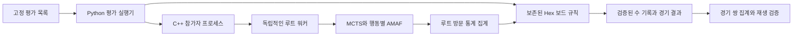

# Hex 게임 AI: 재현 가능한 CPU 탐색

**한국어** | [English](README.md)

몬테카를로 트리 탐색(MCTS), RAVE, 톰슨 샘플링과 C++ 루트 병렬 탐색으로 Hex를 플레이하는 CPU 기반 게임 AI 프로젝트입니다. 기존 프로젝트와 경기 기록을 보존하면서 탐색 통계의 오류를 수정하고, 고정된 대국 목록을 이용한 비교 평가와 소스 빌드 검증을 추가했습니다.

## 프로젝트 개요

| 영역 | 구현 내용 |
| --- | --- |
| 탐색 알고리즘 | 동일한 엔진에서 UCB, 톰슨 샘플링, RAVE-UCB, RAVE-TS 비교 |
| 정확성 | 차례별 승률 해석, 노드별 행동 AMAF 통계, 종료 상태 처리 |
| 네이티브 실행 | C++17, union-find 연결성 판정, 독립적인 루트 워커, 자원 제한 설정 |
| 평가 | 고정 대국 목록, 선후공 교대 쌍, 개발 평가와 최종 평가 분리, 연결 경로 재검증 |
| 재현성 | 표준 라이브러리 기반 Python CLI, 소스 빌드, 경기별 저장, 실행 환경과 빌드 해시 기록 |

현재 에이전트는 실행 중 탐색으로 수를 선택합니다. GPU나 학습된 정책, 신경망 체크포인트가 필요하지 않습니다. 기존의 셀프플레이와 AlphaZero 방식 탐색 자료는 과거 시도의 기록으로 보존하며, 이번 공개 결과를 신경망 학습 성능으로 설명하지 않습니다.

## 핵심 결과

개발 평가 160경기를 모두 완료했으며 실행 실패는 0건이었습니다. 네 정책의 균형 대진에서 RAVE-TS가 48경기 중 44승을 기록해 사전 기준에 따라 선택됐습니다. 이는 정책을 고르는 데 사용한 개발 점수입니다.

| 개발 정책 | 승리 / 완료 경기 | 개발 승률 |
| --- | --- | --- |
| RAVE-TS | 44 / 48 | 91.7% |
| RAVE-UCB | 22 / 48 | 45.8% |
| 톰슨 샘플링 | 18 / 48 | 37.5% |
| UCB | 12 / 48 | 25.0% |

각 정책은 나머지 세 정책과 16경기씩 비교했습니다. 표의 정책별 분모를 더하면 각 경기를 두 번 세게 되므로 네 정책 비교의 전체 규모는 96경기입니다. 별도의 기능 비교는 64경기였습니다. 선택 가능한 변경 네 가지는 모두 채택 기준을 통과하지 못해 중단했으며, 최종 설정은 **RAVE-TS, 브리지 방어 사용, 수 정렬 사용, `rave_k=1000`**으로 고정했습니다. 선택과 해시는 [선택 기록](reports/selection.json) 및 [최종 고정 기록](reports/final-freeze.json)에 있습니다.

<!-- FINAL_RESULTS_BEGIN -->


고정한 최종 대국 256경기의 기록을 확인했습니다. 완료 256경기, 실패 0건, 미기록 0건입니다. 승률 분모는 완료 경기이며 실패를 승리로 바꾸지 않았습니다.

| 상대 | RAVE-TS 승리 / 완료 경기 | 승률 | 완료 쌍 | 쌍 단위 95% 구간 | 실패 |
| --- | --- | --- | --- | --- | --- |
| legacy_ts | 55 / 64 | 85.9% | 32 | 78.1–93.8% | 0 |
| RAVE-UCB | 54 / 64 | 84.4% | 32 | 76.6–92.2% | 0 |
| Thompson sampling | 53 / 64 | 82.8% | 32 | 75.0–90.6% | 0 |
| UCB | 57 / 64 | 89.1% | 32 | 79.7–96.9% | 0 |

새 시드의 결과는 설정 선정에 사용하지 않았습니다. 내부 상대, 강제 시작 조건과 CPU 예산의 범위에서 해석합니다. [최종 집계](reports/aggregates/final-policy.json)에는 환경별 결과와 실패 내역도 있습니다.
<!-- FINAL_RESULTS_END -->

결과는 대국 성능, 실행 안정성, 시뮬레이션 처리량으로 구분해 해석합니다. 탐색의 정확성 수정은 단기 대국에서 승률 상승이 확인되지 않더라도 유지하며, 선택 가능한 설정 변경은 [사전에 정한 실험 계획](reports/study-plan.json)의 채택 기준을 통과한 경우에만 반영합니다.

## 문제와 접근 방법

기존 Python 에이전트는 루트 플레이어의 승리를 모든 노드에 같은 기준으로 저장하고, 상대 차례에도 그 값을 최대화했습니다. 개선 구현은 각 노드에서 수를 둘 플레이어의 승리를 기록하고, 부모가 자식의 수를 평가할 때 승률을 반대로 해석합니다. 이로써 상대도 자신의 승리를 목표로 탐색하도록 수정했습니다.

기존 RAVE 갱신은 트리에서 이미 둔 수를 이후 롤아웃의 수 목록에서 찾는 방식이었습니다. 돌을 놓는 Hex에서는 같은 칸에 다시 둘 수 없으므로 해당 수가 그 목록에 나타나지 않습니다. 개선 구현은 각 조상 노드 이후에 그 노드의 플레이어가 실제로 둔 수를 트리 경로와 롤아웃에서 함께 수집합니다. 이 정보를 노드별 행동 통계인 AMAF로 저장하고, 수를 선택할 때 직접 탐색 통계와 결합합니다.

두 수정은 별도의 정확성 검사로 확인합니다. 기존 C++ 코드의 플레이어별 보상 기준은 Python 코드와 달랐으므로 Python의 상대 차례 오류가 모든 과거 구현에 있었다고 설명하지 않습니다. 읽기 쉬운 [Python 참조 구현](hexai/reference.py)은 보존된 심판의 규칙을 이용하며, 규모가 큰 CPU 실험은 [네이티브 엔진](native/hex_search.cpp)으로 실행합니다.

## 시스템 구조



한 경기의 두 에이전트는 같은 장비에서 실행합니다. 로컬과 Kaggle CPU에 일을 나눌 때도 선후공을 교대한 두 경기 전체를 한 장비에 배정합니다. 알고리즘과 통신 방식, 메모리 제한의 범위는 [아키텍처 설명](docs/architecture.ko.md)에 정리했습니다.

## 실험과 검증

개발 비교에서는 탐색 엔진, 강제 시작 수, 시드, 보드 크기와 수당 전체 탐색 예산을 맞춥니다. 정책과 선택 가능한 기능 설정을 결정한 뒤 새로운 시드로 최종 평가를 진행하며, 최종 결과를 보고 다른 정책으로 다시 선택하지 않습니다.

승리는 수 기록을 재생해 실제 연결 경로가 확인된 경우에만 집계합니다. 불법 수, 응답 시간 초과, 프로세스 오류와 프로토콜 오류는 실패로 별도 기록하고 대국 성능의 승리로 바꾸지 않습니다. 주된 신뢰구간은 완결된 선후공 교대 쌍을 단위로 계산합니다. 경기별 Wilson 구간도 제공하지만 같은 쌍의 두 경기는 서로 연관되므로 보조 지표로 해석합니다.

워커 비교는 전체 시뮬레이션 횟수를 동일하게 유지한 상태에서 진행합니다. 11×11 고정 보드에서 탐색 16,000회의 외부 응답 시간 중앙값은 Windows의 1워커 0.754초, 8워커 0.131초였고, Kaggle에서는 각각 1.897초, 0.683초였습니다. 반복 수는 Windows 7회, Kaggle 5회이며 같은 장비 내 비교로 해석합니다. 워커 8개를 실행해도 물리적인 CPU 코어가 늘어나지는 않습니다. 전체 측정표와 메모리 해석은 [실험 기록](docs/experiments.ko.md)에 있습니다.

최종 고정 횟수 목록은 256경기입니다. 선택하지 않은 세 정책과 현재 엔진의 `legacy_ts` 제어 조건을 상대로 각각 선후공 교대 32쌍을 배정합니다. 별도로 기존 실행 파일과 비교하는 시간 기준 4경기를 마련하지만, 두 엔진의 시간 배분 방식이 다르므로 실행 확인의 범위로 해석하며 충분한 표본의 성능 비교로 제시하지 않습니다.

비교 조건은 [실험 기록](docs/experiments.ko.md)과 [고정한 선택 결과](reports/selection.json), 실행 과정은 [재현 가이드](docs/reproducibility.ko.md)에서 확인할 수 있습니다.

## 한계와 과거 기록

최종 평가는 명시한 내부 상대, 시작 조건과 CPU 예산에서의 결과입니다. 전체 Hex 에이전트의 순위나 Davis 및 HexHex 상대 경기의 재현 결과를 의미하지 않습니다.

기존의 11×11 경기 스크린샷 네 장과 [메타데이터](assets/results/recorded-matches.csv)는 그대로 보존했습니다.

| 과거 에이전트 | 상대 | 기록된 시작 순서 | 결과 |
| --- | --- | --- | --- |
| RAVE-TS | Davis 7 | 선공 | 승리 |
| RAVE-TS | Davis 10 | 선공 | 승리 |
| RAVE-TS | HexHex | 후공 | 패배 |
| MCTS 기준 에이전트 | HexHex | 후공 | 패배 |

Davis는 기존 프로젝트에서 상대한 온라인 사이트 에이전트입니다. 네 장의 이미지는 개별 경기 기록이며, 외부 상대의 실행 파일과 정확한 실행 조건, 당시 전체 토너먼트 CSV는 저장소에 포함되어 있지 않습니다. 보존된 네 경기의 캡처는 이번 내부 정량 평가에 합산하지 않습니다.

새로운 엔진의 `legacy_ts`는 기존 RAVE가 갱신되지 않을 때의 통계 가중 방식을 비교하기 위한 제어 조건입니다. 현재 엔진의 상태 처리와 실행 구조를 공유하므로 기존 실행 파일 자체나 과거 토너먼트의 완전한 재현으로 해석하지 않습니다. 과거 제출본 이후의 모든 변경 효과를 개별적으로 입증하는 비교도 아닙니다.

## 소스에서 실행하기

Python 3.10 이상과 C++17 컴파일러인 `g++`, `clang++` 또는 `zig c++`가 필요합니다. 현재 실행기는 Python 표준 라이브러리만 사용합니다. Windows, Linux 또는 WSL에서 저장소 루트를 기준으로 실행합니다.

```bash
python -m hexai doctor
python -m hexai build
python -m unittest discover -s tests -v
python -m hexai predict --board "R00,000,000" --colour B --turn 2 --policy rave_ts --iterations 1000 --workers 1 --swap 0
```

컴파일러가 자동으로 검색되지 않으면 `PATH`에 추가하거나 `doctor`와 `build`에 `--compiler`를 지정합니다. 빌드 결과와 해시 기록은 `.local/bin/`에 저장되며 기존 배포 실행 파일을 덮어쓰지 않습니다.

개발 단계의 정책 비교를 다시 실행하려면 다음 명령을 사용합니다.

```bash
python -m hexai evaluate --config configs/development-policy.json --output .local/development-policy
python -m hexai evaluate --config configs/development-policy.json --output .local/development-policy --resume
```

두 번째 명령은 동일한 평가 목록을 이어 실행하고 검증된 완료 경기 파일을 건너뜁니다. 종료 시점에 진행 중이던 경기는 다시 실행하지만 이미 완료한 전체 평가를 처음부터 반복하지 않습니다. 전체 대국 비교는 간단한 실행 확인보다 오래 걸립니다. 최종 평가, 로컬과 Kaggle의 분담, 결과 집계와 수 기록 검증은 [재현 가이드](docs/reproducibility.ko.md)를 참고해 주세요.

## 코드와 자료

```text
hexai/                      현재 CLI, 평가 실행기와 Python 참조 구현
native/                     현재 C++17 탐색 소스
configs/                    개발 및 최종 평가의 고정 대국 목록
reports/                    실험 계획, 측정 결과와 공개 검증 자료
tests/                      현재 정확성 검사와 평가 도구 검사
docs/                       영어 기본 문서와 한국어 문서
engine/                     보존된 과제 심판과 기존 Python 에이전트
deployment/                 보존된 기존 네이티브 소스, 실행 파일과 실행 환경
assets/results/             보존된 경기 이미지와 과거 메타데이터
```

소스 ZIP은 공개 저장소와 같은 구조를 사용하고, 개선 구현과 기존 배포 실행 파일을 포함한 과거 자료를 함께 제공합니다. 공개 경기 기록은 `reports/`에 보존하며 새로 생성한 현재 실행 파일, 임시 작업 디렉터리, 인증정보와 개인 기록은 제외합니다. 현재 장비에 맞게 소스에서 빌드하며, Windows 실행 파일을 Linux에서 실행하거나 과거 Linux 실행 파일을 Windows에서 실행하는 방식으로 검증하지 않습니다.

이 저장소는 University of Manchester의 COMP34111 AI & Games 과목 Group 026 프로젝트에서 시작되었습니다. 문서화된 개인 기여는 네 가지 Python 변형, Hex 휴리스틱, C++ 이전과 루트 병렬화입니다. 제공된 심판과 팀 프레임워크는 공동 작업물로 명시합니다. 출처는 [연구 참고문헌](docs/references.md), [기존 연구 README](engine/README.ko.md), [기존 배포 README](deployment/README.ko.md)에서 확인할 수 있습니다.

- [아키텍처](docs/architecture.ko.md) / [English](docs/architecture.md)
- [실험](docs/experiments.ko.md) / [English](docs/experiments.md)
- [재현 가이드](docs/reproducibility.ko.md) / [English](docs/reproducibility.md)
