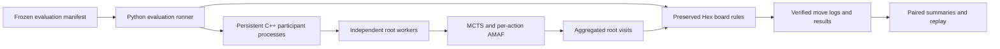

# Hex Game AI: Reproducible CPU Search

[한국어](README.ko.md) | **English**

A CPU-based Hex agent built with Monte Carlo Tree Search (MCTS), Rapid Action Value Estimation (RAVE), Thompson sampling and root-parallel C++ search. This release adds corrected search statistics, frozen paired evaluations and source-build verification while preserving the original project and match evidence.

## Project overview

| Area | Implemented capability |
| --- | --- |
| Algorithms | UCB, Thompson sampling, RAVE-UCB and RAVE-TS in a common maintained engine |
| Correctness | Player-relative values, node-specific same-player AMAF updates and terminal-state handling |
| Native execution | C++17, union-find connectivity, independent root workers and configurable resource limits |
| Evaluation | Frozen manifests, side-reversed pairs, development/final separation and replay-verified connecting paths |
| Reproducibility | Standard-library Python CLI, source builds, per-game checkpoints and environment/build fingerprints |

The maintained agent searches at runtime. It does not require a GPU, a learned policy or a neural checkpoint. The earlier self-play and AlphaZero-style exploration remains historical material, rather than a trained-model performance claim for this release.

## Results

All 160 development games completed with zero execution failures. RAVE-TS won 44 of its 48 balanced round-robin games and was selected by the predefined rule. This score was used for selection and is a development result.

| Development policy | Wins / completed games | Development win rate |
| --- | --- | --- |
| RAVE-TS | 44 / 48 | 91.7% |
| RAVE-UCB | 22 / 48 | 45.8% |
| Thompson sampling | 18 / 48 | 37.5% |
| UCB | 12 / 48 | 25.0% |

Each policy played 16 games against each of the other three policies. Adding the denominators counts every game twice: the policy suite contained 96 games, plus 64 separate feature-comparison games. None of the four optional changes passed its adoption gate, so those candidates were stopped. The frozen configuration is **RAVE-TS, bridge defence enabled, move ordering enabled and `rave_k=1000`**. [Selection](reports/selection.json) and [the final freeze receipt](reports/final-freeze.json) preserve the settings and hashes.

<!-- FINAL_RESULTS_BEGIN -->


All 256 frozen final games are recorded: 256 completed, 0 failed and zero missing. Win rates use completed games; failures are not converted to wins.

| Opponent | RAVE-TS wins / completed games | Win rate | Complete pairs | Paired 95% interval | Failures |
| --- | --- | --- | --- | --- | --- |
| legacy_ts | 55 / 64 | 85.9% | 32 | 78.1–93.8% | 0 |
| RAVE-UCB | 54 / 64 | 84.4% | 32 | 76.6–92.2% | 0 |
| Thompson sampling | 53 / 64 | 82.8% | 32 | 75.0–90.6% | 0 |
| UCB | 57 / 64 | 89.1% | 32 | 79.7–96.9% | 0 |

These new-seed outcomes were not used for selection. They apply to the declared internal opponents, openings and CPU budgets. [The final aggregate](reports/aggregates/final-policy.json) also provides environment-specific results and failure details.
<!-- FINAL_RESULTS_END -->

The measurements distinguish playing strength, execution reliability and simulation throughput. A correctness repair is retained even when a short development comparison does not demonstrate a win-rate increase. Optional settings are adopted only under the criterion declared in [the study plan](reports/study-plan.json).

## Problem and approach

The original Python agents stored wins from the root player's perspective and maximized that value at opponent nodes too. The corrected implementation stores wins for the player to move at each node and inverts a child's value when its parent selects an action.

The original RAVE update also looked for an already played tree action in a later rollout's move list. That action cannot occur again on a placement-only Hex board. The maintained implementation instead records every ancestor's legal future actions played by that ancestor's player, including both tree actions and rollout actions. These AMAF statistics are indexed by node and action, then blended with direct Monte Carlo evidence during selection.

Both repairs are covered by focused tests. The original C++ implementation used a different player-reward convention, so the Python opponent-turn defect is not attributed to every historical implementation. The compact [Python reference](hexai/reference.py) uses the preserved referee's rules for inspection; the [native engine](native/hex_search.cpp) performs the larger CPU experiments.

## System architecture



Each match runs both participants on the same host. Local and Kaggle CPU work is split by complete side-reversal pairs, so a pair never combines two hardware environments. [Architecture details](docs/architecture.md) explain the search conventions, protocol and memory limits.

## Experiments and verification

Development comparisons share the engine, forced opening, seed, board size and total per-move budget. Policy choice and optional feature settings are frozen before the final seed list is evaluated. Final scores are not used to select a replacement policy.

Wins require a replayed connecting path. Illegal moves, response timeouts, process failures and protocol errors remain visible as failures and are not converted into playing-strength wins. The primary interval resamples complete side-reversal pairs; the game-level Wilson interval is descriptive because the two games in a pair are dependent.

Worker benchmarks measure a fixed total simulation count. On a fixed 11×11 board with 16,000 iterations, median external response time fell from 0.754 to 0.131 seconds between one and eight workers on Windows, and from 1.897 to 0.683 seconds on Kaggle. Windows used seven repetitions and Kaggle used five; comparisons apply within each host. Eight workers share the available CPU allocation. [The experiment record](docs/experiments.md) provides the full measurements and memory caveats.

The final fixed-iteration manifest contains 256 games: 32 side-reversal pairs against each of three alternative maintained policies and the maintained `legacy_ts` control. A separate four-game original-executable time reference is an execution check with different time managers, not a large-sample strength comparison.

Read [the experiment record](docs/experiments.md), [the frozen selection](reports/selection.json) and [the reproduction guide](docs/reproducibility.md) before interpreting the comparison tables.

## Limitations and historical evidence

The final tests describe the declared internal opponents, opening distribution and CPU budgets. They do not establish a general Hex ranking or reproduce matches against Davis and HexHex.

Four earlier 11×11 match screenshots and their [metadata](assets/results/recorded-matches.csv) are preserved:

| Historical agent | Opponent | Recorded starting side | Result |
| --- | --- | --- | --- |
| RAVE-TS | Davis 7 | First | Win |
| RAVE-TS | Davis 10 | First | Win |
| RAVE-TS | HexHex | Second | Loss |
| MCTS baseline | HexHex | Second | Loss |

Davis is the online-site opponent identified in the original project. These are individual recorded outcomes. The repository does not bundle the external opponent executables, their exact runtime configuration or an original multi-game tournament CSV. The four preserved captures are not combined with the new internal numerical evaluation.

The maintained `legacy_ts` comparison is a control inside the new engine. It models the old inactive-RAVE count attenuation, while retaining the maintained engine's state handling, execution and other settings. It is not the original executable, an exact reconstruction of the old tournament or a causal isolation of every change since that submission.

## Run from source

Use Python 3.10 or newer and a C++17 compiler (`g++`, `clang++` or `zig c++`). The maintained runtime uses the Python standard library. Run these commands from the repository root on Windows, Linux or WSL:

```bash
python -m hexai doctor
python -m hexai build
python -m unittest discover -s tests -v
python -m hexai predict --board "R00,000,000" --colour B --turn 2 --policy rave_ts --iterations 1000 --workers 1 --swap 0
```

If the compiler is not automatically found, add it to `PATH` or pass `--compiler` to `doctor` and `build`. The build writes a host-specific executable and receipt under `.local/bin/`; it does not replace the original deployment executable.

To repeat the development policy comparison:

```bash
python -m hexai evaluate --config configs/development-policy.json --output .local/development-policy
python -m hexai evaluate --config configs/development-policy.json --output .local/development-policy --resume
```

The second command resumes the same frozen manifest and skips verified completed game files. A stopped in-progress game is rerun; an entire evaluation is not discarded. Full comparisons take longer than the quick checks. [The reproduction guide](docs/reproducibility.md) covers final manifests, local/Kaggle shards, aggregation and saved-game replay.

## Code, data and attribution

```text
hexai/                      Maintained CLI, evaluation runner and readable reference
native/                     Maintained C++17 search source
configs/                    Frozen development and final game manifests
reports/                    Study plan, measured results and release evidence
tests/                      Maintained correctness and evaluation checks
docs/                       English documentation with Korean counterparts
engine/                     Preserved coursework referee and original Python agents
deployment/                 Preserved original native source, binary and runtime
assets/results/             Preserved screenshots and historical match metadata
```

The source ZIP follows the same public repository tree and includes both the maintained implementation and preserved historical material, including the archived deployment binary. Published game records remain under `reports/`; newly generated maintained executables, scratch directories, authentication files and private notes are excluded. Build the maintained executable for the current host rather than running a Windows executable on Linux or an old Linux binary on Windows.

This repository originated as Group 026 coursework for the University of Manchester's COMP34111 AI & Games course. The documented individual contribution covered the four Python variants, Hex heuristics, C++ migration and root parallelization. The supplied referee and team framework remain attributed as shared work. See [research references](docs/references.md), [the original research README](engine/README.md) and [the original deployment README](deployment/README.md) for provenance.

- [Architecture](docs/architecture.md) / [한국어](docs/architecture.ko.md)
- [Experiments](docs/experiments.md) / [한국어](docs/experiments.ko.md)
- [Reproducibility](docs/reproducibility.md) / [한국어](docs/reproducibility.ko.md)
