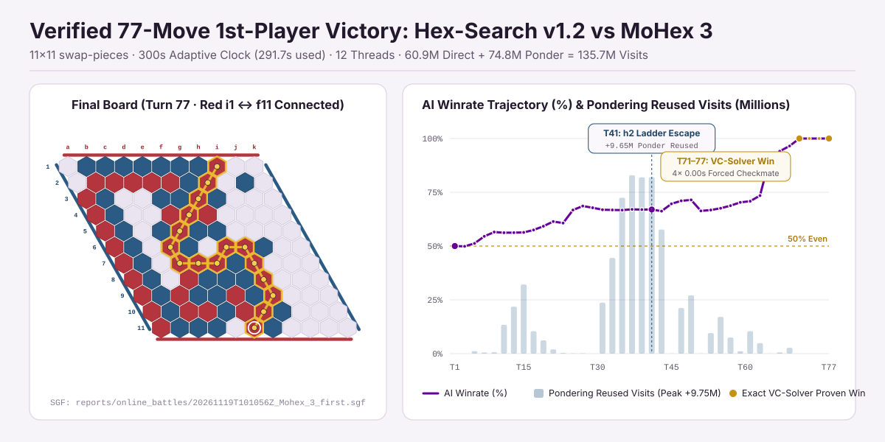
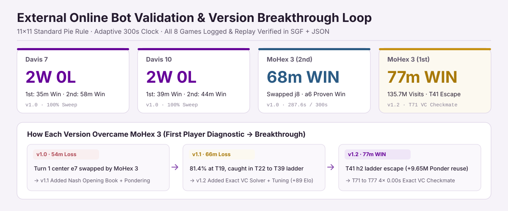
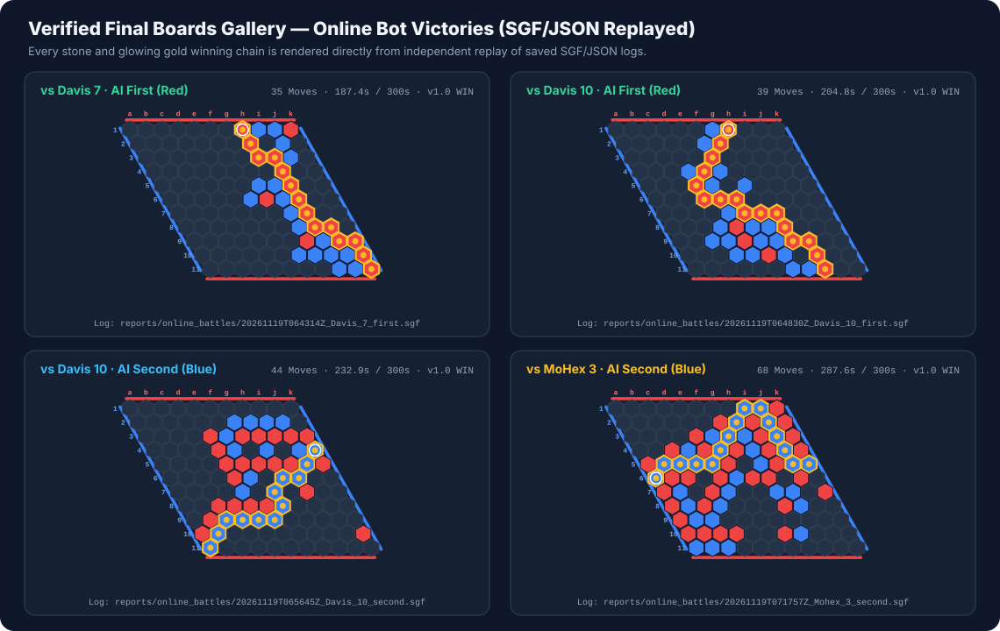
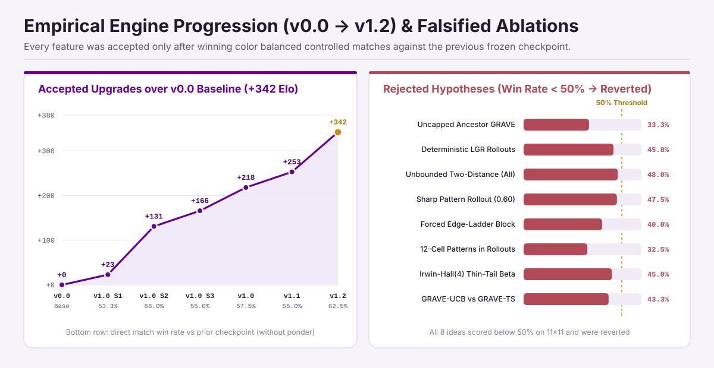

# Hex-Search v1.2 — Pure-CPU C++17 Hex AI Engine

[한국어 README](README.ko.md) · [Technical Architecture (EN)](docs/architecture.md) · [기술 아키텍처 (KO)](docs/architecture.ko.md)

**Hex-Search v1.2** is a zero-dependency, **pure-CPU C++17** search engine for 11×11 Hex — built with no GPU, no deep neural network inference, and zero external libraries.

Starting from the clean `v0.0` core architecture, every upgrade (`v0.0 → v1.0 → v1.1 → v1.2`) was accepted only after winning color-balanced controlled matches against the previous frozen binary. Across four disciplined iterations, pure-CPU strength climbed **`+342 Elo` over `v0.0`**, sweeping online public bots **Davis 7 (2–0)** and **Davis 10 (2–0)** and defeating the classic computer-Hex benchmark **MoHex 3** as **both 2nd player (68 moves) and 1st player (77 moves)**.



---

## 1. Play Directly Against the AI (Customizable GUI Demo)

Anyone with Python 3.10+ and a C++17 compiler (`g++`, `clang++`, or `zig c++`) can build the engine and **play directly against our `v1.2` model** with zero `pip install` dependencies:

```bash
# 1. Build the C++17 binary and run all 26 built-in formal self-tests
python -m hexai build

# 2. Launch the clickable Human vs AI GUI (with presets & custom settings)
python -m hexai play
```

### User-Configurable GUI Features
- **Dual Mode Toggle**: Switch with one click between **`Human vs AI`** (play directly against `hex-search-v1.2`) and **`Online Bot Assistant`** (bridge mode used to play Davis 7/10 and MoHex 3).
- **4 Difficulty Presets**:
  - `Beginner` (`0.5s/move`, 2 threads) · `Intermediate` (`2s/move`, 4 threads) · `Strong` (`5s/move`, 8 threads, Pondering) · **`Grandmaster`** (`300s adaptive V3 clock`, 12 threads, Pondering — full MoHex 3 match spec)
- **Full Custom Controls**: Board size (`7×7 / 9×9 / 11×11`), play as 1st (Red) or 2nd (Blue), fixed seconds/move or total adaptive V3 clock, worker threads, pie rule (`swap-pieces` / `swap-sides`), Pondering ON/OFF, Undo, SGF/JSON export, and automatic **gold winning-chain highlight** at game end.
- **Standard Hex GTP Support**: `./.local/bin/hex_search --gtp --workers 12 --game-seconds 300` (compatible with HexGui, Benzene, and `twogtp`).

---

## 2. Online Benchmark Results & Verified Game Evidence

All external games were played on 11×11 under standard `swap-pieces` pie rule with an adaptive 300-second clock. Raw SGF and JSON logs live in [`reports/online_battles/`](reports/online_battles/), and every board graphic below is deterministically rendered by replaying those exact game records through our independent referee (`tests/test_engine.py`).



### Real Victory Board Gallery (Davis 7 · Davis 10 · MoHex 3 2nd Player)



### Complete Online Match Log (All 8 Games Independently Replay-Verified)

| Opponent Agent | AI Side | Version | Result | Moves | AI Clock / 300s | Key Turning Points & Proof Logs |
| :--- | :---: | :---: | :---: | :---: | :---: | :--- |
| **Davis 7** | 1st (Red) | `v1.0` | **Win** | **35** | 187.4s | Seized central control early; closed with `proven_win` ([SGF](reports/online_battles/20261119T064314Z_Davis_7_first.sgf) · [JSON](reports/online_battles/20261119T064314Z_Davis_7_first.json)) |
| **Davis 7** | 2nd (Blue) | `v1.0` | **Win** | **58** | 272.4s | Swapped `j8`, converted a 58-move battle via `k4` `proven_win` (90.8% clock use) ([SGF](reports/online_battles/20261119T063451Z_Davis_7_second.sgf) · [JSON](reports/online_battles/20261119T063451Z_Davis_7_second.json)) |
| **Davis 10** | 1st (Red) | `v1.0` | **Win** | **39** | 204.8s | Built a clean central span post-swap; 39-move `proven_win` ([SGF](reports/online_battles/20261119T064830Z_Davis_10_first.sgf) · [JSON](reports/online_battles/20261119T064830Z_Davis_10_first.json)) |
| **Davis 10** | 2nd (Blue) | `v1.0` | **Win** | **44** | 232.9s | No-swap middlegame outplay; 44-move Left↔Right connection ([SGF](reports/online_battles/20261119T065645Z_Davis_10_second.sgf) · [JSON](reports/online_battles/20261119T065645Z_Davis_10_second.json)) |
| **MoHex 3** | 2nd (Blue) | `v1.0` | **Win** | **68** | 287.6s | Swapped `j8`, won a 68-move tactical struggle with `a6` `proven_win` ([SGF](reports/online_battles/20261119T071757Z_Mohex_3_second.sgf) · [JSON](reports/online_battles/20261119T071757Z_Mohex_3_second.json)) |
| **MoHex 3** | 1st (Red) | `v1.0` | Loss *(Diag)* | 54 | 260.6s | Played center `e7` on Turn 1 → immediately swapped by MoHex 3 → **motivated `v1.1`** ([SGF](reports/online_battles/20261119T071004Z_Mohex_3_first.sgf) · [JSON](reports/online_battles/20261119T071004Z_Mohex_3_first.json)) |
| **MoHex 3** | 1st (Red) | `v1.1` | Loss *(Diag)* | 66 | 284.7s | Opening book `f9` reached **81.4%** winrate at Turn 19, then overturned on Turns 22–39 top-edge ladder → **motivated `v1.2`** ([SGF](reports/online_battles/20261119T083606Z_Mohex_3_first.sgf) · [JSON](reports/online_battles/20261119T083606Z_Mohex_3_first.json)) |
| **MoHex 3** | 1st (Red) | **`v1.2`** | **Win** | **77** | **291.7s** | **135.7M total visits (+74.8M Pondering), Turn 41 `h2` ladder escape, Turns 71–77 4× `0.00s` Exact VC-Solver checkmate** ([SGF](reports/online_battles/20261119T101056Z_Mohex_3_first.sgf) · [JSON](reports/online_battles/20261119T101056Z_Mohex_3_first.json)) |

---

## 3. Version-by-Version Evolution: What Changed & How It Defeated MoHex 3



### `v0.0` — Clean Pure-CPU MCTS Core Baseline (`0 Elo`)
**Techniques used**:
- **24-Byte Flat Arena Nodes + Lazy Expansion + Separate Flat AMAF Pool**: Eliminates pointer-heavy heap allocations, maximizing CPU cache locality and shrinking memory (RSS) by up to `4.27×`.
- **O(1) Edge-Bitmask Union-Find**: Maintains a 2-bit edge mask (`1 = Start Edge`, `2 = Goal Edge`) per stone component so playout termination is an O(1) check (`edge_flags[root] == 3`) without full-board BFS.
- **2-Ply Subtree Compaction (`rebase_subtree`)**: Compacts and inherits the surviving search subtree across turns instead of discarding prior search work.
- **Exhaustively Verified Dead-Cell Pruning**: Prunes provably useless local cells verified across all **8,784** 3×3 neighborhood configurations with **0 false positives**.
- **Variance-Capped GRAVE-TS**: Combines ancestor AMAF borrowing (GRAVE) with Thompson Sampling while capping borrowed ancestor pseudo-counts at `32` to prevent Beta posterior variance collapse.

---

### `v1.0` — Pure-CPU Strong Engine Architecture (**`72.0%`** vs `v0.0`, cumulative **`+218 Elo`**)
**What changed (4 controlled upgrades)**:
1. **MCTS-Solver + Mustplay (`32/60 = 53.3%` vs `v0.0`, `+23 Elo`)**: Propagates 1-move forced wins (`NODE_PROVEN_WIN`), multi-threat forced losses (`NODE_PROVEN_LOSS`), and single-threat forced defenses (Mustplay) up the tree.
2. **4-Direction Bucket-Queue Two-Distance Potential (`34/50 = 68.0%` vs `v0.0`, `+108 Elo`)**: Computes the minimum stones needed to secure **two independent paths** to both goal edges on the Hex component graph and injects it as a shallow expansion prior (`depth <= 2`) — immediately spotting 11×11 global choke points.
3. **Lock-Free Shared-Tree Parallel MCTS + Virtual Loss (`22/40 = 55.0%` vs S2 Root-Parallel; `80.0%` vs `v0.0`, `+35 Elo`)**: Replaces isolated per-worker trees with a single lock-free shared tree using `state.fetch_or(NODE_EXPANDING, acq_rel)` and atomic `vloss` (`2.0 * vl`), scaling search depth cleanly across 8–12 cores.
4. **Pure-CPU Self-Play 6-Ring Pattern Learning (`23/40 = 57.5%` vs S3; `36/50 = 72.0%` vs `v0.0`, `+52 Elo`)**: Trained 216 4-way canonical symmetric 6-neighbor features via convex L-BFGS-B (Plackett-Luce MLE) on 10,547 pure-CPU self-play moves (`Val Top-1 49.81%`, `Top-5 71.16%`), powering deep priors and O(1) Boltzmann rollouts (`temp=0.35`).

**Breakthrough & Failure Mode Uncovered**:
- This leap swept **Davis 7 (2–0)** and **Davis 10 (2–0)** and beat **MoHex 3 as 2nd player (68 moves)**.
- However, playing **1st vs MoHex 3 (54-move loss)** exposed a blind spot: pie-rule-unaware MCTS spent 12.5 seconds playing dead-center `e7` on Turn 1, which MoHex 3 instantly stole via `swap`, putting us behind from move 2.

---

### `v1.1` — Nash Pie-Rule Opening Book & Real-Time Pondering (**`55.0%`** vs `v1.0`, cumulative **`+253 Elo`**)
**What changed**:
- **Empirically Calibrated 11×11 50.0% Nash Opening Book & Swap Contour**: Swept the full 11×11 winrate contour to play balanced Turn-1 openings (`f9, h2, i2, e3, f3, j4`, etc.) in **`0.00s`**, eliminating center-swap blunders while saving ~12.5s of clock.
- **Deeper Two-Distance Horizon (`depth <= 4`)**: Extended global bottleneck awareness 2 plies deeper at `<2.7%` speed overhead.
- **Lock-Free Opponent-Turn Pondering (`PONDER;` / `STOP_PONDER`)**: As soon as our AI moves, background worker threads continue expanding the shared tree while the opponent thinks; on input, threads join in `<1ms` and hand millions of pre-computed visits directly into `decide()` via 1-ply rebase.

**Breakthrough & Remaining Gap**:
- Even with Pondering disabled in the benchmark, `v1.1` beat frozen `v1.0` `22/40 (55.0%)` and lifted 1st-player balance to `50.0%`.
- In the **MoHex 3 1st-player rematch (66-move loss)**, the `f9` opening book propelled `v1.1` to an **`81.4%` advantage by Turn 19**, before MoHex 3 engineered an edge-ladder comeback across Turns 22–39 where pure rollout depth fell just short of seeing exact virtual connections.

---

### `v1.2` — Exact VC-Solver + MoHex 2.0 Search Tuning (**`62.5%`** vs `v1.1`, cumulative **`+342 Elo`**)
**What changed**:
- **Exact Disjoint-Carrier Virtual Connection (VC) Solver & VC-Mustplay Pruning**: Applying Shannon's Pairing Strategy, whenever a Start-to-Goal chain of 2-bridge hyperedges has pairwise-disjoint empty carrier pairs, the engine proves a **100% forced win 10–15 plies before physical connection** and prunes every root move outside the opponent's 1-move VC threat intersection. Exhaustively cross-checked against an independent minimax oracle across all **19,683** 3×3 boards with **0 false positives**.
- **MoHex 2.0 Search Calibration + Exact-Tail Box-Muller Beta (`alpha >= 16`)**: After empirically proving `GRAVE-TS` beats `GRAVE-UCB` (`73.3%`), we ported `prior_weight=8.0, rave_bias=0.0005, expand_threshold=8` into `GRAVE-TS`, boosting throughput **`+8%`**, defeating frozen `v1.1` **`25/40 (62.5%, First 65.0%, +89 Elo)`**, and triggering **56 early VC-proven wins** in 40 games.

**How `v1.2` Defeated MoHex 3 as 1st Player in 77 Moves** ([full telemetry](reports/online_battles/20261119T101056Z_Mohex_3_first.json)):
1. **Turn 1 (`f9`, `0.01s`)**: Nash opening book saved 13 seconds and held a dead-even `49.87%` start after MoHex 3 swapped.
2. **Turns 35–43 (Pondering Surge + `h2` Ladder Escape)**: MoHex 3 launched the same top-edge ladder (`b1→g1`), but Pondering supplied **`+8.52M` to `+9.75M` reused visits per turn**, letting `v1.2` spot the **`h2` jump (Turn 41) → `g4` lock (Turn 43)** and shatter the ladder (**135.7M total visits = 60.9M direct + 74.8M Pondered**).
3. **Turns 71–77 (Exact VC-Solver `0.00s` Checkmate)**: On Turn 71 (`g10`), `v1.2` proved `vc_proven_win (0.00s)` **7 plies early**, then answered MoHex 3's `h1`, `e6`, `g11` intrusions with four consecutive `0.00s` pairing responses (`i1`, `d7`, `f11`), converting `291.68s / 300s (97.2%)` clock efficiency into a clean victory.

---

## 4. Eight Empirically Falsified & Reverted Hypotheses

Every appealing idea that scored below 50% in controlled matches was reverted and documented:

| Rejected Hypothesis | Controlled Score | Root Cause & Engineering Lesson |
| :--- | :---: | :--- |
| Uncapped Ancestor GRAVE (no `amaf_cap`) | `8/24 (33.3%)` | Large ancestor AMAF counts collapsed Beta posterior variance → capping at `32` flipped it to `56.7%` |
| Deterministic LGR Rollouts | `11/24 (45.8%)` | Deterministic replies correlated rollouts and biased AMAF estimates |
| Unbounded Two-Distance (all depths) | `24/50 (48.0%)` | Running Dijkstra at deep leaves cut speed `-18%` → restricting to shallow depths jumped winrate to `68.0%` |
| Sharp Pattern Rollout (`temp=0.60`) | `19/40 (47.5%)` | Over-greedy rollouts reduced AMAF exploration diversity (`temp=0.35` scored `57.5%`) |
| Forced Edge-Ladder Rollout Block | `16/40 (40.0%)` | Wasted tempo 100% of the time on irrelevant dead edges, polluting AMAF |
| 12-Cell Patterns Inside Rollouts (`Ring6+Bridge6`) | `13/40 (32.5%)` | Validation Top-1 rose `+4.96%p` but rollout throughput dropped `-34.7%` |
| Irwin-Hall(4) Approximate Beta Sampler | `18/40 (45.0%)` | `+19%` faster, but thin bounded tails weakened Thompson Sampling right-tail exploration |
| `GRAVE-UCB` vs `GRAVE-TS` | Std `8/30 (26.7%)`, Tuned `13/30 (43.3%)` | Lost decisively to Variance-Capped `GRAVE-TS` despite `+35%` higher iteration count |

---

## 5. Repository Layout & One-Command Verification

```text
native/hex_search.cpp            # Single pure-CPU C++17 Hex engine v1.2.0 (26/26 self-tests)
hexai/
  referee.py                     # Self-contained Hex board, BFS winning-chain tracker, pie-rule referee
  native.py                      # Cross-platform C++17 builder & thread-safe subprocess telemetry
  evaluation.py                  # Color-balanced match runner & paired-bootstrap CI harness
  battle_gui.py                  # Dual-mode Human vs AI & Online Bot Assistant Tkinter GUI
  battle.py                      # Terminal CLI battle assistant + standard SGF/JSON logger
  cli.py                         # Unified CLI (build, play, gui, battle, evaluate, benchmark, replay)
tests/test_engine.py             # Unit, protocol, GTP, Pondering, GUI & 8-game SGF/JSON replay suite
scripts/generate_figures.py      # Deterministic generator for all 5 SVG visual evidence assets
reports/
  benchmarks/progression_summary.json
  online_battles/                # Raw SGF + JSON logs for Davis 7, Davis 10, and MoHex 3
assets/                          # Generated 5 SVG proof graphics
docs/                            # English & Korean deep-dive architecture documents
```

```bash
# Full reproducible verification (build + 26/26 C++ self-tests + 12/12 Python/SGF tests + SVG check)
python -m hexai build
python -m unittest discover -s tests -v
python scripts/generate_figures.py --check
```
