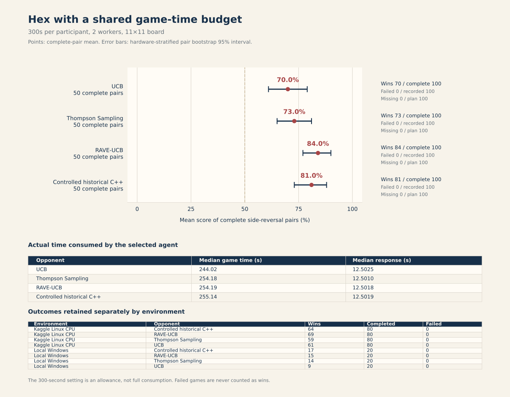
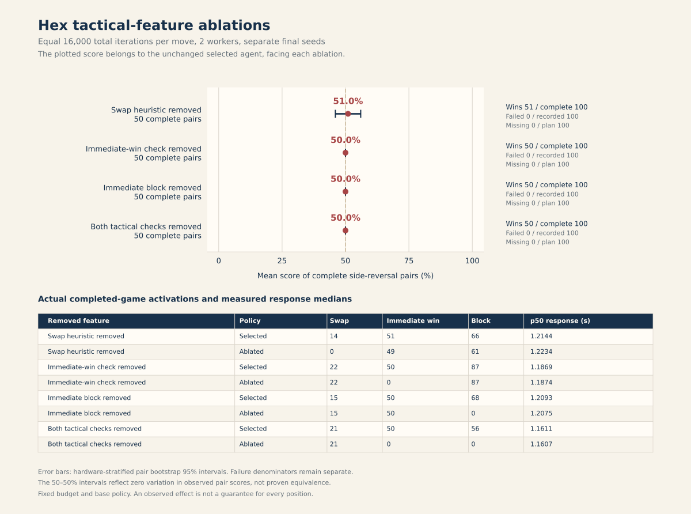
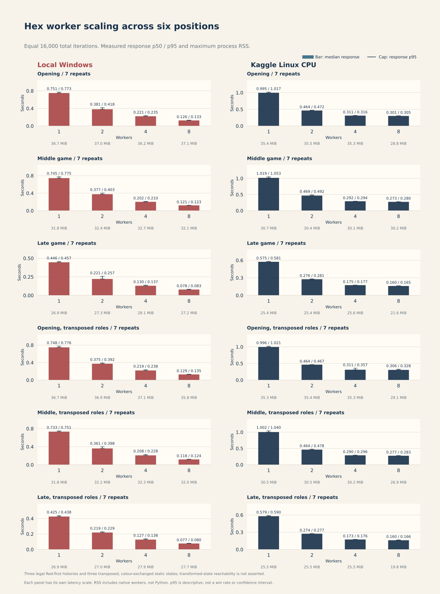
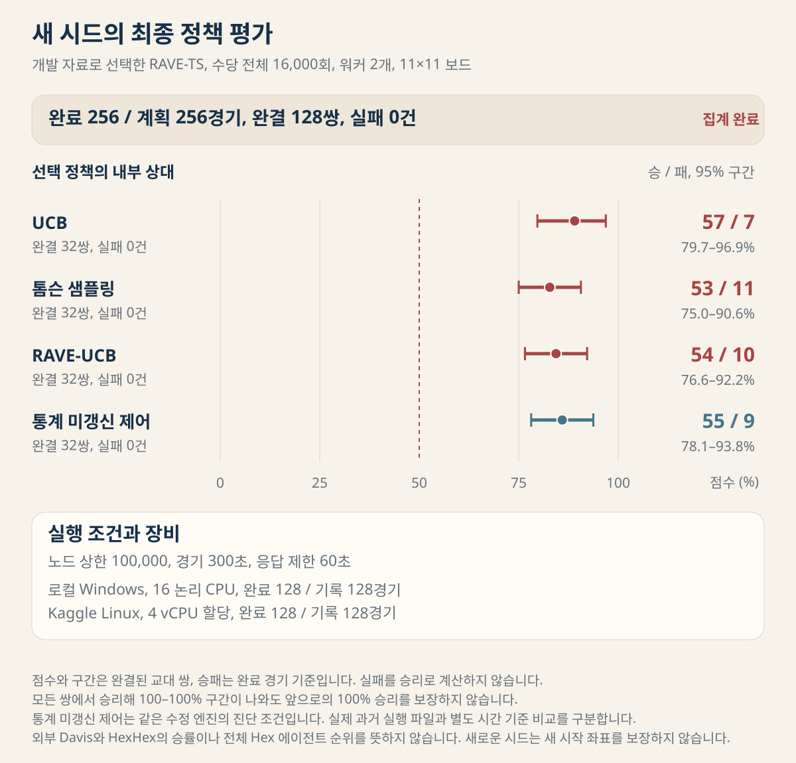
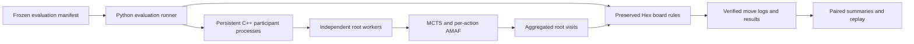

# Hex Game AI: Reproducible CPU Search

[한국어](README.ko.md) | **English**

[Portfolio case study](https://park-dongmyung.com/projects/project-06/) | [Download source and evaluation records](https://park-dongmyung.com/downloads/ai-and-games-source/)

A CPU-based Hex agent built with Monte Carlo Tree Search (MCTS), Rapid Action Value Estimation (RAVE), Thompson sampling and root-parallel C++ search. The maintained release combines corrected search statistics, frozen paired evaluation, matching external game budgets and source-build verification while preserving the original project and match evidence.

Here, **initial agent** refers to the first submitted Python and C++ implementations; **current agent** refers to the maintained public implementation with corrected search statistics and execution tools.

## Project overview

| Area | Implemented capability |
| --- | --- |
| Algorithms | UCB, Thompson sampling, RAVE-UCB and RAVE-TS in a common maintained engine |
| Correctness | Player-relative values, node-specific same-player AMAF updates and terminal-state handling |
| Native execution | C++17, union-find connectivity, independent root workers and configurable resource limits |
| Evaluation | Frozen manifests, side-reversed pairs, development/final separation and replay-verified connecting paths |
| Reproducibility | Standard-library Python CLI, source builds, per-game checkpoints and environment/build fingerprints |

The maintained agent searches at runtime. It does not require a GPU, a learned policy or a neural checkpoint. The earlier self-play and AlphaZero-style exploration remains historical material, rather than a trained-model performance claim for this release.

## Deeper verification of the selected agent

The extended release tests the existing selected configuration more thoroughly.
It adds a real external **300-second per-agent game allowance**, a controlled
comparison with the initial algorithm, individual tactical ablations and
six-position worker measurements. RAVE-TS with bridge defence, move ordering
and `rave_k=1000` remains selected. These additional final results do not select
a replacement policy. Results and their validation scope remain separate.

| Evaluation | What is held constant | Declared new scope |
| --- | --- | --- |
| Shared game time | Same host, two workers per agent and the same external time allocator | Four opponents, 100 games and 50 side-reversal pairs each |
| Tactical ablation | Same maintained engine, 16,000 total iterations per move and two workers | Swap, immediate-win check, immediate block and both checks removed separately, 100 games each |
| Worker benchmark | Same six nonterminal positions and equal total iteration budgets | Workers 1, 2, 4 and 8, measured separately on Windows and Kaggle |

The prior **532 games and 16,768 replayed moves remain preserved**. Their
development selection, final fixed-iteration results, short equal-time additions
and four original-source reference games are not relabelled as the new study.
New evaluation seeds are separate from the earlier manifests; a new seed does
not guarantee a previously unseen opening coordinate.

### Same time allowance, rather than only the same iteration count



All 400 scheduled shared-time games were recorded and completed, with zero failures and zero missing games.

| Opponent | RAVE-TS wins / completed games | Completed-game win rate | Complete pairs | Pair-bootstrap 95% interval | Failures / scheduled games |
| --- | ---: | ---: | ---: | ---: | ---: |
| Controlled initial algorithm (`benchmark_legacy`) | 81 / 100 | 81.0% | 50 | 73.0–88.0% | 0 / 100 |
| RAVE-UCB | 84 / 100 | 84.0% | 50 | 77.0–90.0% | 0 / 100 |
| Thompson sampling (TS) | 73 / 100 | 73.0% | 50 | 65.0–81.0% | 0 / 100 |
| UCB | 70 / 100 | 70.0% | 50 | 61.0–79.0% | 0 / 100 |

The 300-second value is a ceiling for all measured responses by each participant,
not a promise to consume 300 seconds in every game. The referee measures pipe
latency and sends the same adaptive per-move allocator to both engines through
V3. Tactical decisions and earlier game endings can leave part of the allowance
unused. Report the measured time consumed alongside the completed-game win
rate, failure denominator, missing results and complete-pair count.

The primary paired interval resamples complete side-reversal pairs within
hardware and source-adapter strata. Windows and Kaggle outcomes remain separately
visible. Two independent games may share a CPU job; this is not an isolated
latency benchmark. Results apply to the specified internal opponents and budget.

The [shared-time aggregate](reports/deep/aggregates/shared-time.json) and [response and memory measurements](reports/deep/analysis/shared-time-costs.json) retain actual denominators. Each opponent has 20 Windows games, 60 Xeon Kaggle games and 20 EPYC Kaggle games. The Windows UCB stratum scored 9/20, so the pooled score does not establish superiority on every host. All 18,514 requests and 800 participant-game time accounts stayed within the external allowance. Node caps restrict tree expansion while rollouts continue. The historical memory allocator remains preserved, so matching time and workers does not imply an equal-RAM experiment.

### Individual tactical contributions and execution costs



All 400 tactical games completed, with zero failures and zero missing games.

| Removed feature | Selected wins / completed games | Complete pairs | Pair mean and 95% interval |
| --- | ---: | ---: | --- |
| Swap heuristic | 51 / 100 | 50 | 51.0%, 46.0–56.0% |
| Immediate-win check | 50 / 100 | 50 | 50.0%, 50.0–50.0% |
| Immediate block | 50 / 100 | 50 | 50.0%, 50.0–50.0% |
| Both tactical checks | 50 / 100 | 50 | 50.0%, 50.0–50.0% |

These outcomes do not demonstrate a strength gain. Each observed pair in the
three immediate-check comparisons split one win each, so their empirical
pair-bootstrap intervals collapse to 50–50%. This is zero variance in the
observed pair scores, not exact population strength or evidence of equivalence.
Recorded full physical traces were identical in 48/50 immediate-win pairs and
27/50 pairs for both block and combined checks. The differing immediate-win
traces changed only the final winning coordinate. All 7,407 shared ordinary-search
positions across the four comparisons recorded the same worker seeds and moves.

At 50 matched winning positions, the immediate check's median external response
was 0.191 ms versus 231.654 ms for ordinary search. At 68 matched blocking
positions, it was 0.256 ms versus 687.677 ms. These are conditional responses
at the same input; some chosen actions differ. They are not whole-agent speedup
factors. Median response across all moves remained about 1.16–1.22 seconds.
The fixed selected policy was not retuned using these final diagnostics.

The four ablations are related diagnostic comparisons. Report actual swap,
immediate-win and block activations as well as measured response times. Rare
activations can limit the information in a win-rate comparison. Failure to detect
an effect does not establish feature equivalence, and an unadjusted interval is
not used to announce a significant result across four comparisons.



Windows and Kaggle Linux each completed 168 searches on the same fixture hash: 336 requests in total. Six states, four worker settings and seven repeats used exactly 16,000 total iterations per request, giving 2,688,000 iterations per host and 5,376,000 combined.

Three states replay legal Red-first histories at turns 2, 41 and 81. Three counterparts transpose those boards and exchange colours; they are static nonterminal states, not asserted reachable Red-first match histories.

| Environment | 4 vs 1 workers: median latency speedup | 8 vs 4: median time reduction | Observed logical CPUs |
| --- | --- | --- | --- |
| Local Windows | 3.34–3.68× | 39.52–43.33% | 16 |
| Kaggle Linux | 3.20–3.49× | 1.60–8.36% | 4 |

Ratios are calculated within each environment. Hardware, compiler and operating system differ together, so cross-host differences do not isolate an algorithm improvement or an operating-system effect. Kaggle ran eight workers within a four-CPU allocation; this does not provide eight CPU cores.

Cells show request-to-response p50 / p95 in milliseconds. p95 is a descriptive linear interpolation of seven observations.

**Local Windows**

| State | 1 worker | 2 workers | 4 workers | 8 workers |
| --- | --- | --- | --- | --- |
| Opening, turn 2 | 750.8 / 772.8 | 380.9 / 418.0 | 221.4 / 235.4 | 126.1 / 132.5 |
| Middle, turn 41 | 744.5 / 775.3 | 377.1 / 403.3 | 202.1 / 210.5 | 120.8 / 122.6 |
| Late, turn 81 | 446.0 / 456.9 | 220.9 / 256.9 | 129.6 / 137.5 | 78.4 / 82.9 |
| Opening static symmetry | 748.1 / 776.0 | 374.6 / 392.5 | 219.4 / 238.1 | 128.7 / 134.6 |
| Middle static symmetry | 733.3 / 751.0 | 361.1 / 398.3 | 207.9 / 227.9 | 117.8 / 123.6 |
| Late static symmetry | 425.5 / 438.4 | 219.0 / 229.4 | 127.3 / 138.0 | 76.9 / 80.2 |

Maximum recorded native-process peak RSS across seven repeats per setting, MiB:

| State | 1 worker | 2 workers | 4 workers | 8 workers |
| --- | --- | --- | --- | --- |
| Opening, turn 2 | 36.73 | 36.96 | 36.21 | 37.12 |
| Middle, turn 41 | 31.84 | 32.39 | 32.70 | 32.06 |
| Late, turn 81 | 26.91 | 27.31 | 28.07 | 27.20 |
| Opening static symmetry | 36.74 | 36.86 | 37.13 | 35.83 |
| Middle static symmetry | 31.84 | 32.21 | 32.29 | 31.97 |
| Late static symmetry | 26.88 | 26.99 | 27.89 | 27.69 |

**Kaggle Linux**

| State | 1 worker | 2 workers | 4 workers | 8 workers |
| --- | --- | --- | --- | --- |
| Opening, turn 2 | 994.7 / 1017.2 | 463.5 / 472.0 | 310.5 / 316.4 | 300.9 / 304.7 |
| Middle, turn 41 | 1018.6 / 1053.0 | 469.1 / 492.0 | 292.1 / 293.6 | 273.2 / 279.9 |
| Late, turn 81 | 574.6 / 580.6 | 276.2 / 281.2 | 175.1 / 177.0 | 160.5 / 164.6 |
| Opening static symmetry | 996.4 / 1021.1 | 463.6 / 466.6 | 310.5 / 356.9 | 305.6 / 327.6 |
| Middle static symmetry | 1002.1 / 1039.9 | 464.1 / 477.6 | 289.8 / 296.2 | 276.7 / 282.7 |
| Late static symmetry | 578.6 / 590.0 | 273.9 / 276.8 | 173.2 / 175.8 | 160.4 / 166.1 |

Maximum recorded native-process peak RSS across seven repeats per setting, MiB:

| State | 1 worker | 2 workers | 4 workers | 8 workers |
| --- | --- | --- | --- | --- |
| Opening, turn 2 | 35.41 | 35.52 | 35.26 | 28.77 |
| Middle, turn 41 | 30.67 | 30.38 | 30.14 | 30.20 |
| Late, turn 81 | 25.39 | 25.36 | 25.62 | 21.57 |
| Opening static symmetry | 35.29 | 35.40 | 35.29 | 29.07 |
| Middle static symmetry | 30.48 | 30.46 | 30.23 | 26.86 |
| Late static symmetry | 25.48 | 25.45 | 25.48 | 19.75 |

Every response selected a legal empty cell, and per-worker iterations summed to exactly 16,000. Recorded node-cap hits: 0. RSS includes native workers and excludes the Python driver. Windows records PeakWorkingSetSize and Linux records VmHWM; the cross-host memory values do not come from an identical measurement API. The memory setting bounds native node pools; it is not an OS-enforced whole-process memory ceiling. Swap and immediate tactical shortcuts were disabled, so every request followed the search path.

Each request used a fresh native process, and settings ran in fixed order. The request-to-response clock excludes the Python process-creation call but can include native initialization still in progress. Dividing iterations among independent trees changes trajectories and work per iteration, so ratios are not pure parallel efficiency or playing-strength gains. Seven-repeat p95 values do not precisely estimate a production tail. These outcomes did not retune the selected policy. Raw records remain in `reports/deep/benchmarks/windows.json` and `reports/deep/benchmarks/kaggle.json`.

Worker figures retain per-position p50 and p95 response times and process peak
RSS for each host. RSS includes native workers and excludes the Python driver.
Missing memory measurements remain unavailable, rather than becoming zero.
More worker threads do not create more CPU cores, and throughput is not a win rate.
The [optional Matplotlib figure tools](tools/figures/) require Python 3.11 or
newer and remain separate from the Python 3.10-or-newer runtime.

### Three different historical controls

| Control | Meaning |
| --- | --- |
| `legacy_ts` | A diagnostic policy inside the maintained engine, not the original source |
| Preserved original source rebuilt with `--legacy` | Initial algorithm and original eight-worker time manager; its old four-game comparison is preserved separately |
| `benchmark_legacy` | Initial algorithm with guarded runtime-only changes for seeded workers, matching external budgets, deadline polling and telemetry |

The controlled adapter retains the historical selection, expansion, rollout,
rewards, swap and tactical logic, including inactive AMAF statistics. Its patch
receipt and generated source are auditable. It is not the byte-identical original
executable. The original per-worker iteration safety limit and unbounded tree
growth remain; the maintained engine's node and memory allowances are explicit
settings rather than an equal-RSS comparison.

The public CPU packaging tool has also been executed end to end on Kaggle:
source extraction and hash checks, source builds, maintained and original tests,
ASan/UBSan checks and four short V3 games completed. This validates the tool's
execution path, not the strength of a 300-second agent or an independent external
review by another person. Detailed definitions, manifests and commands are in
[the extended experiment record](docs/experiments.md) and
[the reproduction guide](docs/reproducibility.md).

The latest actual public CPU-tool Kaggle execution passed 107 Python test executions, 15 native self-test checks and six ASan/UBSan protocol checks. All four short V3 games completed and all 100 saved moves replayed. A separate checkpoint-only execution stopped before its first evaluation game and recorded zero games. Neither integration nor checkpoint evidence is added to the 400-game strength study. [Public execution evidence](docs/deep-runtime.md) retains source-version scope.

## Preserved fixed-iteration results

All 160 development games completed with zero execution failures. RAVE-TS won 44 of its 48 balanced round-robin games and was selected by the predefined rule. This score was used for selection and is a development result.

| Development policy | Wins / completed games | Development win rate |
| --- | --- | --- |
| RAVE-TS | 44 / 48 | 91.7% |
| RAVE-UCB | 22 / 48 | 45.8% |
| Thompson sampling | 18 / 48 | 37.5% |
| UCB | 12 / 48 | 25.0% |

Each policy played 16 games against each of the other three policies. Adding the denominators counts every game twice: the policy suite contained 96 games, plus 64 separate feature-comparison games. None of the four optional changes passed its adoption gate, so those candidates were stopped. The frozen configuration is **RAVE-TS, bridge defence enabled, move ordering enabled and `rave_k=1000`**. [Selection](reports/selection.json) and [the final freeze receipt](reports/final-freeze.json) preserve the settings and hashes.

<!-- FINAL_RESULTS_BEGIN -->


All 256 frozen final games are recorded: 256 completed, 0 failed and zero missing. Win rates use completed games; failures are not converted to wins.

| Opponent | RAVE-TS wins / completed games | Win rate | Complete pairs | Paired 95% interval | Failures |
| --- | --- | --- | --- | --- | --- |
| legacy_ts | 55 / 64 | 85.9% | 32 | 78.1–93.8% | 0 |
| RAVE-UCB | 54 / 64 | 84.4% | 32 | 76.6–92.2% | 0 |
| Thompson sampling | 53 / 64 | 82.8% | 32 | 75.0–90.6% | 0 |
| UCB | 57 / 64 | 89.1% | 32 | 79.7–96.9% | 0 |

These new-seed outcomes were not used for selection. They apply to the declared internal opponents, openings and CPU budgets. [The final aggregate](reports/aggregates/final-policy.json) also provides environment-specific results and failure details.
<!-- FINAL_RESULTS_END -->

The measurements distinguish playing strength, execution reliability and simulation throughput. A correctness repair is retained even when a short development comparison does not demonstrate a win-rate increase. Optional settings are adopted only under the criterion declared in [the study plan](reports/study-plan.json).

## Problem and approach

The initial Python agents stored wins from the root player's perspective and maximized that value at opponent nodes too. The corrected implementation stores wins for the player to move at each node and inverts a child's value when its parent selects an action.

The initial RAVE update also looked for an already played tree action in a later rollout's move list. That action cannot occur again on a placement-only Hex board. The maintained implementation instead records every ancestor's legal future actions played by that ancestor's player, including both tree actions and rollout actions. These AMAF statistics are indexed by node and action, then blended with direct Monte Carlo evidence during selection.

Both repairs are covered by focused tests. The initial C++ implementation used a different player-reward convention, so the Python opponent-turn defect is not attributed to every historical implementation. The compact [Python reference](hexai/reference.py) uses the preserved referee's rules for inspection; the [native engine](native/hex_search.cpp) performs the larger CPU experiments.

The frozen 61-position 11×11 scenario set passed all 488 responses, all 244 V2/V3 move-and-reason comparisons and four invalid-input or terminal-state rejection checks. [The scenario receipt](reports/deep/correctness/scenarios/receipt.json) records correctness separately from playing strength.

## System architecture



Each match runs both participants on the same host. Local and Kaggle CPU work is split by complete side-reversal pairs, so a pair never combines two hardware environments. [Architecture details](docs/architecture.md) explain the search conventions, protocol and memory limits.

## Experiments and verification

Development comparisons share the engine, forced opening, seed, board size and total per-move budget. Policy choice and optional feature settings are frozen before the final seed list is evaluated. Final scores are not used to select a replacement policy.

Wins require a replayed connecting path. Illegal moves, response timeouts, process failures and protocol errors remain visible as failures and are not converted into playing-strength wins. The primary interval resamples complete side-reversal pairs; the game-level Wilson interval is descriptive because the two games in a pair are dependent.

The preserved first-release single-position worker benchmarks measured a fixed total simulation count. On a fixed 11×11 board with 16,000 iterations, median external response time fell from 0.754 to 0.131 seconds between one and eight workers on Windows, and from 1.897 to 0.683 seconds on Kaggle. Windows used seven repetitions and Kaggle used five; comparisons apply within each host. Eight workers share the available CPU allocation. [The experiment record](docs/experiments.md) provides the full measurements and memory caveats.

The final fixed-iteration manifest contains 256 games: 32 side-reversal pairs against each of three alternative maintained policies and the maintained `legacy_ts` control. A separate four-game original-executable time reference is an execution check with different time managers, not a large-sample strength comparison.

Read [the experiment record](docs/experiments.md), [the frozen selection](reports/selection.json) and [the reproduction guide](docs/reproducibility.md) before interpreting the comparison tables.

## Limitations and historical evidence

The final tests describe the declared internal opponents, opening distribution and CPU budgets. They do not establish a general Hex ranking or reproduce matches against Davis and HexHex.

Four earlier 11×11 match screenshots and their [metadata](assets/results/recorded-matches.csv) are preserved:

| Historical agent | Opponent | Recorded starting side | Result |
| --- | --- | --- | --- |
| RAVE-TS | Davis 7 | First | Win |
| RAVE-TS | Davis 10 | First | Win |
| RAVE-TS | HexHex | Second | Loss |
| MCTS baseline | HexHex | Second | Loss |

Davis is the online-site opponent identified in the original project. These are individual recorded outcomes. The repository does not bundle the external opponent executables, their exact runtime configuration or an original multi-game tournament CSV. The four preserved captures are not combined with the new internal numerical evaluation.

The maintained `legacy_ts` comparison is a control inside the new engine. It models the old inactive-RAVE count attenuation, while retaining the maintained engine's state handling, execution and other settings. It is not the original executable, an exact reconstruction of the old tournament or a causal isolation of every change since that submission.

## Run from source

Use Python 3.10 or newer and a C++17 compiler (`g++`, `clang++` or `zig c++`). The maintained runtime uses the Python standard library. Run these commands from the repository root on Windows, Linux or WSL:

```bash
python -m hexai doctor
python -m hexai build
python -m unittest discover -s tests -v
python -m hexai predict --board "R00,000,000" --colour B --turn 2 --policy rave_ts --iterations 1000 --workers 1 --swap 0
```

If the compiler is not automatically found, add it to `PATH` or pass `--compiler` to `doctor` and `build`. The build writes a host-specific executable and receipt under `.local/bin/`; it does not replace the original deployment executable.

To repeat the development policy comparison:

```bash
python -m hexai evaluate --config configs/development-policy.json --output .local/development-policy
python -m hexai evaluate --config configs/development-policy.json --output .local/development-policy --resume
```

The second command resumes the same frozen manifest and skips verified completed game files. A stopped in-progress game is rerun; an entire evaluation is not discarded. Full comparisons take longer than the quick checks. [The reproduction guide](docs/reproducibility.md) covers final manifests, local/Kaggle shards, aggregation and saved-game replay.

## Code, data and attribution

```text
hexai/                      Maintained CLI, evaluation runner and readable reference
native/                     Maintained C++17 search source
configs/                    Frozen development and final game manifests
reports/                    Study plan, measured results and release evidence
tests/                      Maintained correctness and evaluation checks
docs/                       English documentation with Korean counterparts
engine/                     Preserved coursework referee and initial Python agents
deployment/                 Preserved original native source, binary and runtime
assets/results/             Preserved screenshots and historical match metadata
```

The source ZIP follows the same public repository tree and includes both the maintained implementation and preserved historical material, including the archived deployment binary. Published game records remain under `reports/`; newly generated maintained executables, scratch directories, authentication files and private notes are excluded. Build the maintained executable for the current host rather than running a Windows executable on Linux or an old Linux binary on Windows.

This repository originated as Group 026 coursework for the University of Manchester's COMP34111 AI & Games course. The documented individual contribution covered the four Python variants, Hex heuristics, C++ migration and root parallelization. The supplied referee and team framework remain attributed as shared work. See [research references](docs/references.md), [the original research README](engine/README.md) and [the original deployment README](deployment/README.md) for provenance.

- [Architecture](docs/architecture.md) / [한국어](docs/architecture.ko.md)
- [Experiments](docs/experiments.md) / [한국어](docs/experiments.ko.md)
- [Reproducibility](docs/reproducibility.md) / [한국어](docs/reproducibility.ko.md)
- [Limitations](docs/limitations.md) / [한국어](docs/limitations.ko.md)


[Optional analysis tools](tools/analysis/) reanalyze recorded data without new games or policy selection.
