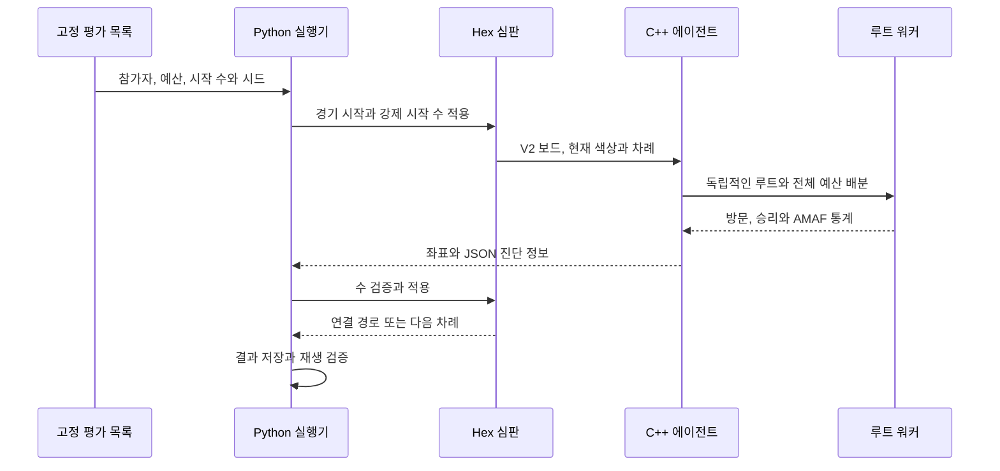

# 아키텍처

**한국어** | [English](architecture.md) | [프로젝트 개요](../README.ko.md)

## 구성 요소와 실행 흐름

현재 구현은 [`hexai/`](../hexai/)와 [`native/hex_search.cpp`](../native/hex_search.cpp)에 있습니다. 기존 `engine/`과 `deployment/`는 과거 자료로 보존합니다. 새로운 심판 래퍼는 보존된 `Board`와 `Colour`를 가져와 사용하며, 승리 연결성의 정의를 다른 규칙으로 대체하지 않습니다.

| 구성 요소 | 역할 |
| --- | --- |
| `hexai/cli.py` | 빌드, 환경 확인, 평가, 벤치마크, 평가 목록 검사와 경기 재생 |
| `hexai/native.py` | 컴파일러 검색, 빌드 해시, 에이전트 프로세스와 외부 시간 제한 |
| `hexai/referee.py` | 합법 수, 플레이어 신원, 파이 룰에 따른 색상 변경과 연결 경로 승리 판정 |
| `hexai/evaluation.py` | 고정 평가 목록, 경기 쌍 단위 작업 분배, 저장, 실패 처리와 통계 집계 |
| `hexai/reference.py` | 알고리즘의 정확성을 확인하는 고정 시드 Python MCTS 참조 구현 |
| `native/hex_search.cpp` | CPU 자원 제한을 적용하는 탐색과 수별 진단 정보 |



각 경기에서는 참가자별로 지속 실행하는 네이티브 프로세스를 만듭니다. 표준 출력은 `x,y` 좌표만 전달하며, 표준 오류는 JSON 진단 정보를 전달합니다. 두 스트림을 별도 스레드로 읽어 진단 출력 때문에 수 응답이 막히는 문제를 방지합니다. 외부에서 측정하는 응답 제한은 엔진 자체의 시간 제한과 별도로 적용합니다.

## 보드와 종료 상태

Red는 위와 아래를 연결하고 Blue는 왼쪽과 오른쪽을 연결합니다. 네이티브 보드는 크기 3부터 19까지 지원하며, 돌의 색상과 빈 칸 인덱스, union-find 연결 상태를 고정 크기 배열로 저장합니다. 돌을 놓으면 같은 색상의 이웃과 해당 목표 가장자리를 합치고, 가장자리의 대표 노드가 같은지 비교해 승리를 판정합니다.

트리에서 수를 두거나 롤아웃에서 수를 둘 때마다 승리를 확인하고, 종료된 상태는 확장하지 않습니다. 네이티브 자체 검사는 3×3 보드의 19,683개 색상 배치를 대상으로 두 색상의 union-find 결과와 독립적인 그래프 탐색 결과를 비교합니다. 이는 보드 연결성 검사이며 에이전트의 전체 대국 성능 측정은 아닙니다.

심판 래퍼는 기존 파이 룰을 유지합니다. 스왑은 두 번째 차례에만 허용되며 Red와 Blue에 배정된 플레이어가 바뀝니다. 네이티브 요청마다 현재 색상을 전달하므로 스왑을 선택한 플레이어와 그 상대 모두 올바른 관점으로 다음 수를 탐색합니다.

## 노드의 승률 기준

각 노드의 `visits`는 해당 노드를 통과한 시뮬레이션 수이며, `wins`는 그 노드에서 수를 둘 플레이어인 `to_play`가 승리한 횟수입니다. 자식 노드의 플레이어는 부모의 상대이므로 부모가 그 수를 평가할 때는 다음과 같이 해석합니다.

```text
부모 플레이어의 MC 승리 수 = child.visits - child.wins
부모 관점의 수 가치       = 1 - child.wins / child.visits
```

이 규칙은 모든 깊이에 적용합니다. 기존 Python 구현에서 상대 차례에도 루트 플레이어의 승리를 최대화하던 문제를 수정한 부분입니다. 기존 C++ 에이전트는 다른 방식의 플레이어별 보상 기준을 이미 사용했으므로 이 Python 오류가 모든 과거 코드에 있었던 것처럼 설명하지 않습니다.

## AMAF와 RAVE

각 시뮬레이션은 수와 그 수를 둔 색상을 함께 기록합니다. 방문한 노드마다 해당 상태에 도달한 직후의 기록 인덱스를 저장하고, 역전파에서는 그 인덱스 이후에 해당 노드의 `to_play`가 둔 수만 사용합니다. 따라서 자식 노드에 도달하기 위해 둔 수는 자식의 통계에 포함되지 않지만, 조상 노드의 통계에는 조건을 만족하는 미래의 트리 수와 롤아웃 수가 함께 반영됩니다.

AMAF는 해당 시뮬레이션에서 선택한 자식 하나가 아니라 **노드와 행동의 조합**에 저장합니다. Hex에서는 돌을 제거하거나 같은 칸에 다시 두지 않으므로 이후의 합법 수는 그 조상 상태에서도 비어 있던 칸입니다. Python 참조 구현은 노드의 합법 수 집합을 추가로 확인하고 한 시뮬레이션에서 같은 행동을 중복 집계하지 않습니다.

이 방식은 기존 구현이 이미 차지한 트리 수를 이후 롤아웃에서 찾던 문제를 해결합니다. 기존 코드를 그대로 남겨 오류를 확인하는 과정도 과거 자료를 수정하지 않고 살펴볼 수 있게 했습니다.

행동에 AMAF 통계가 있을 때 결합 가중치는 다음과 같습니다.

```text
beta = sqrt(k / (3 * node.visits + k))
```

| 정책 | 선택 방식 |
| --- | --- |
| `ucb` | 부모 관점의 MC 가치에 탐색 항 추가 |
| `ts` | Beta(MC 승리 수 + 1, MC 패배 수 + 1)에서 표본 추출 |
| `rave_ucb` | MC와 AMAF 가치를 `beta`로 결합한 뒤 탐색 항 추가 |
| `rave_ts` | MC와 AMAF의 승패 횟수를 `beta`로 결합한 뒤 베타 분포에서 표본 추출 |

노드의 직접 방문이 늘면 RAVE의 비중이 줄어듭니다. 이는 명시한 구현 선택이며 특정 논문의 코드를 정확히 재현했다는 의미는 아닙니다. `k`와 기타 설정은 평가 목록에 기록합니다. 현재 CLI와 간단한 Python 참조 구현의 기본값은 같지 않을 수 있으므로 실험에서는 목록에 고정한 설정을 사용합니다.

추가 제어 조건인 `legacy_ts`는 AMAF를 갱신하지 않습니다. 기존 RAVE가 갱신되지 않을 때의 직접 통계 가중치를 `child.visits / (1000 + child.visits)`로 근사하고 Beta(1,1) 사전분포를 더합니다. 원래 식의 분모에 더하던 매우 작은 보정값은 생략했습니다. 현재 엔진의 실행 구조와 나머지 설정을 공유하며, 보존된 과거 실행 파일 자체는 아닙니다.

## 병렬 탐색과 자원 제한

워커마다 보드 복사본, 트리, 난수 생성기와 수 기록을 따로 관리합니다. 탐색 중에는 가변 트리 통계를 공유하지 않습니다. 종료 후 루트 행동의 방문 수와 부모 관점 승리 수를 합쳐 가장 많이 방문한 합법 수를 선택하고, 동률 처리는 명시한 결정적 규칙을 따릅니다.

`--iterations`는 **수 하나를 선택하기 위해 전체 워커에 배정하는 횟수**입니다. 워커마다 같은 횟수를 추가하는 설정이 아닙니다. 전체 97회를 워커 네 개에 배정하면 25회, 24회, 24회, 24회가 됩니다. 워커 시드는 설정 시드, 보드, 차례, 색상과 워커 번호로 만듭니다. 워커 수가 바뀌면 탐색 구성도 바뀌므로 동일한 설정의 반복 실행을 검증하며 다른 워커 수의 결과가 같다고 보장하지 않습니다.

`--node-cap`은 전체 워커의 트리 노드 수를 제한합니다. `--memory-mb`도 보수적인 노드 수 제한을 계산하는 데 사용하지만, 전체 프로세스나 Python 실행기에 대한 운영체제 수준의 강제 제한은 아닙니다. 실제 프로세스 최대 RSS는 별도로 측정합니다. 노드 제한이 지나치게 작아 루트 자식 통계가 없으면 합법 수로 대체 선택하며, 이를 충분한 탐색에 따른 강한 추천으로 해석하지 않습니다.

고정 횟수 모드에서도 경기 시간과 외부 응답 제한은 적용됩니다. 시간 모드는 새 시뮬레이션을 시작하기 전에 단조 시계 기준 제한을 검사하고 완료한 시뮬레이션만 기록합니다. 워커 시작, 이미 진행 중인 시뮬레이션 하나와 결과 직렬화에는 추가 시간이 들 수 있으므로 심판의 외부 제한도 필요합니다.

## Hex 휴리스틱과 해석

네이티브 엔진은 브리지 방어 롤아웃, 수 정렬, 파이 룰 선택과 즉시 승리 및 차단 검사를 지원합니다. 브리지 방어는 상대가 두 연결 칸 중 하나를 차지했을 때 남은 칸으로 같은 색상의 끝점을 연결합니다. 수 정렬은 중앙과 주변 연결에 도움이 되는 칸을 우선합니다. 모두 탐색에 사용하는 휴리스틱이며 완전한 Hex 해법은 아닙니다.

즉시 승리하는 수가 있으면 우선 선택합니다. 상대의 즉시 승리 칸 하나를 막더라도 서로 다른 위협이 여러 개면 방어 성공이 보장되지 않습니다. 실험 보고서에는 적용한 기능과 개발 채택 기준을 통과한 제거 실험을 명시합니다. 전체 에이전트가 한 경기에서 승리했다는 이유만으로 개별 기능의 개선 효과를 인정하지 않습니다.

## 평가에 고정한 구성

[선택 기록](../reports/selection.json)의 최종 구성은 RAVE-TS, 브리지 방어 사용, 수 정렬 사용, `rave_k=1000`입니다. 개발 비교는 전체 수당 4,000회, 최종 정책 비교 목록은 16,000회이며 둘 다 워커 두 개를 사용합니다. 전술 검사와 스왑은 평가 목록의 기본 설정대로 사용합니다. 원본 시간 기준 확인만 워커 여덟 개를 사용합니다.

원시 네이티브 실행 파일의 `--rave-k` 기본값은 **300**이고 Python CLI 및 선정한 평가 설정은 **1000**입니다. 명시한 대국을 재현할 때는 [최종 평가 목록](../configs/final-policy.json)과 [고정 해시](../reports/final-freeze.json)를 기준으로 삼습니다. 구현 자체의 구조가 같다고 서로 다른 설정이나 시간 제한의 결과를 같은 실험으로 합치지 않습니다.

## 검증 기록

빌드 기록에는 소스, 컴파일러와 실행 파일의 해시를 저장합니다. 평가 메타데이터에는 실행기 파일의 해시와 장비 할당 정보도 포함합니다. 경기별 JSON은 수, 플레이어 신원, 색상, 명령, 진단 통계, 실행 시간과 실패 상태를 기록합니다. 재생 검증은 보드를 다시 구성하고 기록된 승리의 연결 경로를 확인합니다. 집계는 서로 다른 평가 목록과 중복 경기 ID를 거부합니다.

기존 프레임워크와 실행 파일, 경기 이미지 네 장은 별도 목록으로 보존 여부를 확인합니다. 이는 출처와 보존 상태의 검사이며 과거의 모든 탐색 성능 설명을 소급해 검증하는 것은 아닙니다.
