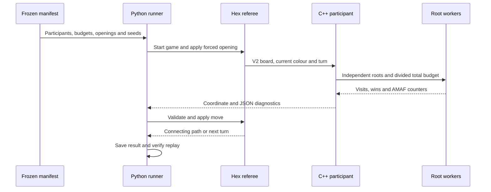

# Architecture

[한국어](architecture.ko.md) | **English** | [Project overview](../README.md)

## Components and execution flow

The maintained implementation lives in [`hexai/`](../hexai/) and [`native/hex_search.cpp`](../native/hex_search.cpp). The original `engine/` and `deployment/` remain historical artifacts. The new referee wrapper imports the preserved `Board` and `Colour` rules rather than replacing their connectivity definition.

| Component | Responsibility |
| --- | --- |
| `hexai/cli.py` | Build, inspect, evaluate, benchmark, validate manifests and replay games |
| `hexai/native.py` | Compiler discovery, build fingerprints, persistent engine processes and external timeouts |
| `hexai/referee.py` | Move validation, player identity, pie-rule colour changes and connecting-path wins |
| `hexai/evaluation.py` | Frozen manifests, pair-preserving shards, checkpoints, failures and statistical summaries |
| `hexai/reference.py` | Readable, seeded Python MCTS reference for algorithm correctness |
| `native/hex_search.cpp` | Resource-bounded CPU search and structured per-move diagnostics |



One persistent native process is created for each participant in a game. Standard output carries only `x,y`; standard error carries JSON diagnostics. Separate reader threads drain both streams so diagnostic output cannot block the move response. An external measured response deadline is enforced independently of the engine's own deadline.

## Board and terminal states

Red connects the top and bottom edges; Blue connects the left and right edges. The native board supports sizes 3 through 19 and stores colours, empty-cell indices and union-find connectivity in fixed-size arrays. Playing a stone unions its same-colour neighbours and matching virtual edges. Winner detection compares the relevant edge representatives.

Search checks for a winner after each tree action and rollout action. A terminal state is not expanded. The native self-test compares both colours' connectivity against an independent graph traversal for all 19,683 colourings of a 3×3 board. This validates board connectivity, not overall playing strength.

The game wrapper preserves the original pie rule. A swap is legal only on turn two and exchanges player identities assigned to Red and Blue. Every native request carries the current colour, so both the swap initiator and its opponent continue from the correct perspective.

## Node-value convention

For a node with player `to_play`, `visits` is the number of simulations through that node and `wins` is the number won by `to_play`. A child's player is the parent's opponent. The parent's direct estimate for that action is therefore:

```text
MC wins for the parent = child.visits - child.wins
MC action value       = 1 - child.wins / child.visits
```

This convention applies at every depth. It fixes the original Python behavior that rewarded the root player at opponent nodes and still maximized that reward. The original C++ agent already used a different player-relative reward convention; the Python defect should not be attributed to all historical code.

## AMAF and RAVE

Every simulation records actions with the colour that played them. Each visited node stores the history index immediately after reaching its state. Backpropagation uses only the suffix from that index and only actions played by that node's `to_play` colour. Thus a child does not record the action that led into it, while an ancestor records eligible future tree actions as well as rollout actions.

AMAF counters belong to a **node and action**, rather than only to the child chosen in that simulation. Future placements are legal at the ancestor because Hex does not remove or replay stones. The Python reference additionally filters against the node's legal-action set and deduplicates each continuation.

This corrects the historical update's attempt to match an already occupied tree move against later rollout moves. Keeping the original code makes the defect probe inspectable without rewriting the historical evidence.

When an action has AMAF evidence, the blend is:

```text
beta = sqrt(k / (3 * node.visits + k))
```

| Policy | Selection rule |
| --- | --- |
| `ucb` | Parent-relative MC value plus an exploration term |
| `ts` | Sample from Beta(MC wins + 1, MC losses + 1) |
| `rave_ucb` | Blend MC and AMAF action values with `beta`, then add exploration |
| `rave_ts` | Blend MC and AMAF win/loss counts with `beta`, then sample from a beta distribution |

RAVE evidence is gradually reduced as the node receives more direct visits. This is a documented engineering choice, not a claim of exact reproduction of a particular paper's implementation. `k` and other settings are recorded in each frozen manifest. The maintained CLI's defaults and the compact Python reference's defaults need not be identical; experiments use explicit manifest settings.

The additional `legacy_ts` control has no AMAF updates. It approximates the old inactive-RAVE direct-count weight as `child.visits / (1000 + child.visits)` before adding a Beta(1,1) prior, omitting the original formula's tiny denominator epsilon. It shares the maintained engine's runtime and remaining settings. It is not the preserved historical binary.

## Parallel search and resource limits

Each worker owns a board copy, tree, random generator and history. Workers share no mutable tree statistics during a move. Their root action visits and parent-relative wins are summed after joining; the most visited legal root action is chosen, with recorded deterministic tie handling.

`--iterations` is a **total per-move budget across workers**, not a per-worker budget. A total of 97 across four workers is allocated as 25, 24, 24 and 24. Seeds are derived from the configured seed, board, turn, colour and worker index. Increasing the worker count changes the search ensemble, so equality is promised for repeated identical configurations, not between different worker counts.

`--node-cap` bounds total tree nodes across workers. `--memory-mb` derives an additional conservative tree-node allowance. It is not an operating-system hard cap on the complete process or Python runner. Actual process peak RSS is measured separately. Very small caps may leave no root child statistics and require a legal fallback; such a fallback is not evidence of a strong recommendation.

Fixed-iteration mode also respects the finite game budget and external response timeout. Time mode checks a monotonic deadline before every new simulation and records only completed simulations. Worker launch, one in-progress simulation and serialization can still add overhead, so the referee's external timeout remains necessary.

## Hex heuristics and interpretation

The native engine supports bridge-saving rollouts, ordered expansion, pie-rule selection and immediate tactical win/block scans. A bridge-save connects friendly endpoints through the remaining carrier after an opponent occupies the other carrier. Move ordering prioritizes central and locally useful cells. These are heuristic preferences, not a complete Hex solver.

Immediate winning moves take priority. Blocking one immediate opponent winning cell does not guarantee defence when multiple distinct threats exist. The experiment report states which options were enabled and which ablations met the development adoption criterion. No feature is credited with an isolated improvement solely because the full agent wins one game.

## Frozen evaluation configuration

[The selected configuration](../reports/selection.json) is RAVE-TS with bridge defence and move ordering enabled and `rave_k=1000`. Development comparisons use 4,000 total iterations per move; the final policy manifest uses 16,000. Both use two workers, with tactical checks and swaps enabled by their declared defaults. Only the original-source time reference uses eight workers.

The raw native executable defaults `--rave-k` to **300**; the Python CLI and selected evaluation setting use **1000**. Reproduction follows [the final manifest](../configs/final-policy.json) and [its frozen hashes](../reports/final-freeze.json). A common implementation does not make results under different settings or time limits interchangeable.

## Audit trail

Build receipts include source, compiler and executable hashes. Evaluation metadata additionally records the runner hashes and host allocation. Per-game JSON preserves moves, player identities, colours, commands, diagnostic counters, execution time and failure status. Replay reconstructs the board and confirms a recorded winner's connecting path. Statistical aggregation rejects mixed manifests and duplicate game identifiers.

The original framework, binary and four recorded-match images are inventoried independently. Their preservation is a provenance check; it does not retrospectively validate every historical search claim.
