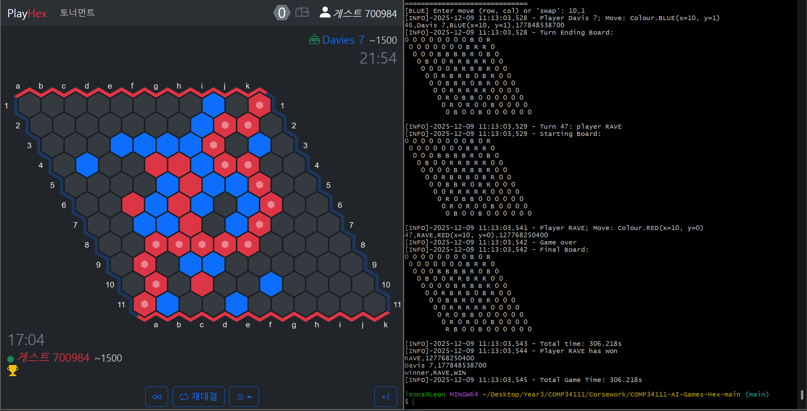
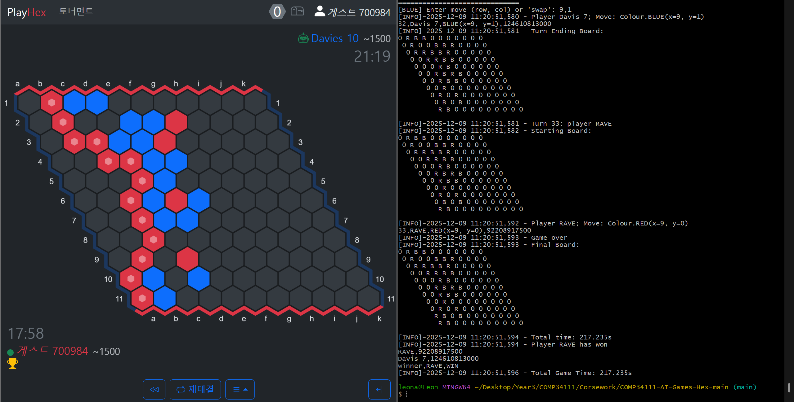
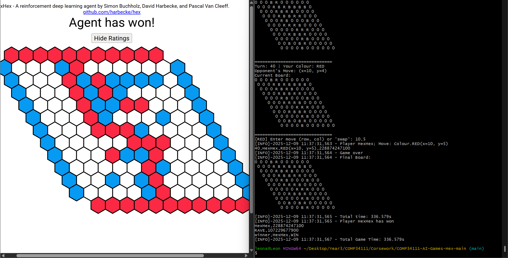
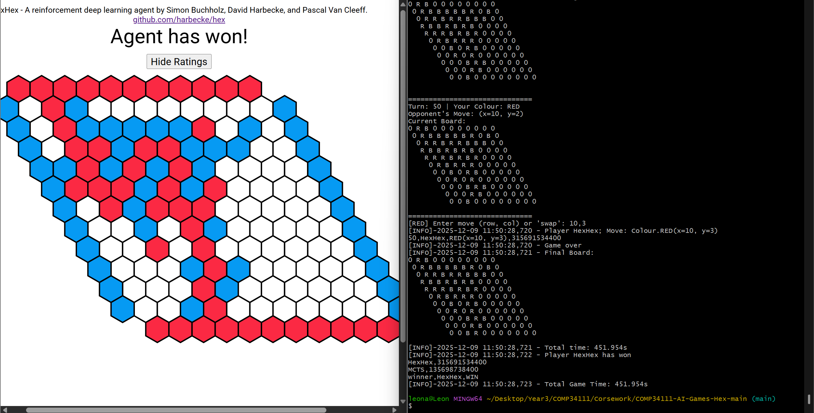

# Experiments and Evidence

[한국어](experiments.ko.md) | **English** | [Project overview](../README.md)

## Questions and scope

Which selection policy is strongest in a common CPU search engine? Do bridge defence, move ordering or a different RAVE weight improve the declared development matchups? How do root-worker counts affect response time and memory under an equal total iteration budget?

This work covers CPU search, correctness repairs, recorded games, parallel measurements and reproducibility tools. It does not retrain a neural model. The original Python research agents, original C++ submission and historical external-opponent images remain preserved as distinct evidence.

## Procedure fixed before results

[The study plan](../reports/study-plan.json) was frozen before development outcomes. Development comparisons used 11×11 boards, 4,000 total iterations per move across two workers, a 100,000-node cap, a 300-second per-player game ceiling and a 60-second response deadline. The two legs of a side-reversal pair shared the seed and forced opening and ran on the same host. Local Windows and Kaggle CPU records are also summarized separately by environment.

| Manifest | Purpose | Games / side-reversal pairs |
| --- | --- | --- |
| `development-policy` | Four-policy round robin | 96 / 48 |
| `development-features` | Four optional RAVE-TS changes | 64 / 32 |
| `final-policy` | Selected policy against four controls, new seeds | 256 / 128 |
| `final-time-reference` | Execution reference against rebuilt original source | 4 / 2 |
| `supplemental-time-policy` | Equal-time policy comparison | 48 / 24 |
| `supplemental-workers` | Equal-time worker-count matches | 64 / 32 |

Policy selection uses balanced completed-game scores. Ties retain RAVE-TS, then follow the declared policy order. An optional change requires at least a 55% score and a paired-bootstrap 95% lower bound **strictly above** 50%. Failed candidates are stopped. Correctness repairs are not optional features rolled back according to win rate.

[The final-plan addendum](../reports/final-plan-addendum.json) explains excluding a selected policy from its own opponents and adding `legacy_ts` as a diagnostic control. [Selection](../reports/selection.json) and [the freeze receipt](../reports/final-freeze.json) pin the settings and final-manifest hashes.

## Development policy comparison: 96 completed games, zero failures

| Policy | Wins / completed games | Development selection score |
| --- | --- | --- |
| RAVE-TS | 44 / 48 | 91.7% |
| RAVE-UCB | 22 / 48 | 45.8% |
| Thompson sampling | 18 / 48 | 37.5% |
| UCB | 12 / 48 | 25.0% |

Each game contributes once to each participant's score, so the policy denominators sum to 192 for 96 games. **RAVE-TS was selected** using these scores; they are not independent final estimates.

| Left policy | Right policy | Left wins / completed games | Complete pairs | Paired 95% interval for left score |
| --- | --- | --- | --- | --- |
| RAVE-TS | RAVE-UCB | 14 / 16 | 8 | 68.8–100% |
| RAVE-TS | Thompson sampling | 14 / 16 | 8 | 75.0–100% |
| RAVE-TS | UCB | 16 / 16 | 8 | 100–100% |
| RAVE-UCB | Thompson sampling | 9 / 16 | 8 | 25.0–87.5% |
| RAVE-UCB | UCB | 11 / 16 | 8 | 43.8–87.7% |
| Thompson sampling | UCB | 9 / 16 | 8 | 37.5–75.0% |

Intervals resample observed complete pairs 2,000 times with bootstrap seed 378. If all observed pairs are wins, the empirical nonparametric interval can collapse to 100–100%. This does not guarantee future wins or establish generalization beyond the small development sample and observed openings. Game-level Wilson intervals are descriptive fields in the aggregate JSON.

## Optional features: 64 completed games, zero failures

The full baseline is RAVE-TS with bridge defence and move ordering enabled and `rave_k=1000`. Rates and intervals below are from the **candidate's** perspective against that baseline.

| Candidate change | Candidate wins / completed games | Candidate score | Paired 95% interval | Adoption |
| --- | --- | --- | --- | --- |
| Remove bridge defence | 3 / 16 | 18.8% | 0–37.5% | Stopped |
| Remove move ordering | 8 / 16 | 50.0% | 25.0–75.0% | Stopped |
| `rave_k=300` | 8 / 16 | 50.0% | 18.8–81.2% | Stopped |
| `rave_k=3000` | 12 / 16 | 75.0% | 50.0–100% | Stopped |

Each comparison contains eight complete pairs. `rave_k=3000` had the highest point score but a lower bound of exactly 50%, so it failed the strict adoption gate. Retaining move ordering does not establish a measured isolated benefit from ordering. The final configuration remained RAVE-TS, bridge defence and ordering enabled, `rave_k=1000`, with no further candidate tuning.

## Worker throughput and memory: measured results

The common 11×11 snapshot has Red at `(0,0)` and Blue to move on turn two. Swap is disabled and **16,000 total iterations** are divided across 1, 2, 4 and 8 workers. Trial seeds start at 378, with bridge defence and ordering enabled. Windows used seven repeats and Kaggle five; every trial completed exactly 16,000 iterations.

| Host | Workers | Median external response, seconds | External iterations/second | Speedup over one worker | Maximum native peak RSS, MiB |
| --- | --- | --- | --- | --- | --- |
| Windows | 1 | 0.754 | 21,216 | 1.00× | 36.7 |
| Windows | 2 | 0.396 | 40,420 | 1.91× | 37.0 |
| Windows | 4 | 0.231 | 69,383 | 3.27× | 37.3 |
| Windows | 8 | 0.131 | 122,474 | 5.77× | 38.1 |
| Kaggle CPU | 1 | 1.897 | 8,436 | 1.00× | 35.6 |
| Kaggle CPU | 2 | 0.980 | 16,321 | 1.93× | 35.3 |
| Kaggle CPU | 4 | 0.714 | 22,413 | 2.66× | 35.1 |
| Kaggle CPU | 8 | 0.683 | 23,412 | 2.78× | 32.7 |

Throughput is the median of completed iterations divided by externally measured response time; speedup compares that metric within the same host. RSS is the largest per-process peak across repeats and excludes the Python runner. Different tree partitions, allocation and trajectories mean RSS need not rise monotonically with workers.

Windows recorded Python 3.12.7 and 16 visible logical CPUs. Kaggle recorded x86_64 Linux, Python 3.13.15 and four visible and affinity CPUs. Its `cpu.max=400000 100000` provided four CPUs of time allocation. These hosts used different toolchains and processors; cross-host throughput is not an algorithmic improvement factor. Kaggle's small observed gain from four to eight workers is also specific to this snapshot and session.

This is a **single-snapshot throughput benchmark**. It is not a match win rate or mean response time throughout a game. Worker-count playing outcomes appear in the separate time-budget experiment below. Raw repeats are in [the Windows JSON](../reports/benchmarks/windows.json) and [the Kaggle JSON](../reports/benchmarks/kaggle.json).

## Final evaluation

<!-- FINAL_RESULTS_BEGIN -->
All 256 frozen final games are recorded: 256 completed, 0 failed and zero missing. Win rates use completed games; failures are not converted to wins.

| Opponent | RAVE-TS wins / completed games | Win rate | Complete pairs | Paired 95% interval | Failures |
| --- | --- | --- | --- | --- | --- |
| legacy_ts | 55 / 64 | 85.9% | 32 | 78.1–93.8% | 0 |
| RAVE-UCB | 54 / 64 | 84.4% | 32 | 76.6–92.2% | 0 |
| Thompson sampling | 53 / 64 | 82.8% | 32 | 75.0–90.6% | 0 |
| UCB | 57 / 64 | 89.1% | 32 | 79.7–96.9% | 0 |

These new-seed outcomes were not used for selection. They apply to the declared internal opponents, openings and CPU budgets. [The final aggregate](../reports/aggregates/final-policy.json) also provides environment-specific results and failure details.
<!-- FINAL_RESULTS_END -->

`legacy_ts` is a diagnostic inside the maintained engine with AMAF disabled and the historical direct-count attenuation. It is neither the original executable nor an exact replay of its games. Conclusions remain conditional on the declared internal opponents, openings, budgets and implementation.

## Original-source time reference

<!-- ORIGINAL_REFERENCE_BEGIN -->
The rebuilt-original time reference records 4 games: 4 completed and 0 failed. Selected RAVE-TS won 4/4 completed games. Both agents use eight workers and a 300-second per-player ceiling; only the maintained engine has a five-second per-move cap. This is an execution check over two pairs with different time managers. [Time-reference aggregate](../reports/aggregates/final-time-reference.json)
<!-- ORIGINAL_REFERENCE_END -->

This checks two executions with different time managers. It is not an equal-time same-engine policy ablation or a statistical improvement claim against the old submission. The shipped historical Linux binary remains preserved and receives a separate hash and portability check.

## Equal-time policy comparison

[The supplemental plan](../reports/supplemental-plan.json) was declared after primary final execution began but before supplemental outcomes. These two suites are exploratory additions, not initially declared confirmatory tests. Both use a 100,000-node cap, a declared 128 MiB tree allowance, a 300-second per-player ceiling and a 30-second response deadline.

<!-- SUPPLEMENTAL_TIME_BEGIN -->
All 48 supplemental games are recorded: 48 completed, 0 failed and zero missing.

| Opponent | RAVE-TS wins / completed games | Win rate | Complete pairs | Paired 95% interval | Failures |
| --- | --- | --- | --- | --- | --- |
| RAVE-UCB | 12 / 16 | 75.0% | 8 | 56.2–93.8% | 0 |
| Thompson sampling | 13 / 16 | 81.2% | 8 | 56.2–100.0% | 0 |
| UCB | 14 / 16 | 87.5% | 8 | 75.0–100.0% | 0 |

The per-move cap is 0.25 seconds, with same-host side-reversal pairs and fixed openings. This exploratory addition was not used to reselect the policy or worker setting. [Supplemental aggregate](../reports/aggregates/supplemental-time-policy.json)
<!-- SUPPLEMENTAL_TIME_END -->

## Worker-count matches under equal time

<!-- SUPPLEMENTAL_WORKERS_BEGIN -->
All 64 supplemental games are recorded: 64 completed, 0 failed and zero missing.

| Condition | RAVE-TS wins / completed games | Win rate | Complete pairs | Paired 95% interval | Failures |
| --- | --- | --- | --- | --- | --- |
| RAVE-TS w1 vs UCB w2 | 12 / 16 | 75.0% | 8 | 56.2–93.8% | 0 |
| RAVE-TS w2 vs UCB w2 | 16 / 16 | 100.0% | 8 | 100.0–100.0% | 0 |
| RAVE-TS w4 vs UCB w2 | 14 / 16 | 87.5% | 8 | 75.0–100.0% | 0 |
| RAVE-TS w8 vs UCB w2 | 14 / 16 | 87.5% | 8 | 68.8–100.0% | 0 |

The per-move cap is 0.25 seconds, with same-host side-reversal pairs and fixed openings. This exploratory addition was not used to reselect the policy or worker setting. [Supplemental aggregate](../reports/aggregates/supplemental-workers.json) Total CPU work differs; every condition faces UCB with two workers.
<!-- SUPPLEMENTAL_WORKERS_END -->

This holds per-move wall time and the opponent fixed, not total CPU work. Eight workers share Kaggle's four-CPU allocation. Each condition has only eight pairs: report intervals and failures and avoid superiority claims based on small score differences.

## Correctness and preservation evidence

In the Python diagnostic on an empty 3×3 board with 1,000 iterations, historical RAVE updated zero times while the corrected reference recorded 13,772 AMAF updates. An independent aggregation also counted 13,772. This demonstrates active statistics in that diagnostic; it is not evidence of improved win rate or throughput.

The native self-test compares both colours on all 19,683 possible 3×3 assignments against BFS connectivity, and checks node-specific updates, opponent turns, terminal states, tactics and resource limits. [The original inventory](../reports/baseline/original-source-inventory.json) pins preserved source and match assets. [The reproducibility guide](reproducibility.md) explains saved-bundle verification and new execution.

## Preserved external-opponent games

[Recorded-match metadata](../assets/results/recorded-matches.csv) identifies four historical 11×11 executions. The external Davis and HexHex executables and complete original tournament CSV are unavailable; new internal games are not claimed to reproduce those matchups.

| Historical match | Recorded result |
| --- | --- |
| RAVE-TS vs Davis 7, first | Win after 47 turns |
| RAVE-TS vs Davis 10, first | Win after 33 turns |
| RAVE-TS vs HexHex, second | Loss after 40 turns |
| MCTS baseline vs HexHex, second | Loss after 50 turns |

These images support individual outcomes. Incomplete opponent, seed and hardware records prevent treating them as a measured win rate. Differences in turn count between separate games do not establish an improvement factor.

## Scope and interpretation

The earlier strengthening plan also requests same-engine policy comparisons under both equal iterations and equal time, and actual playing-strength scores for 1, 2, 4 and 8 workers. Fixed-iteration development comparisons and single-snapshot worker throughput are complete. Final fixed-iteration, original-source time-reference and supplemental match manifests are recorded separately. Equal-time policy and worker-count outcomes are described only from their respective verified supplemental results, without changing the selected policy.
